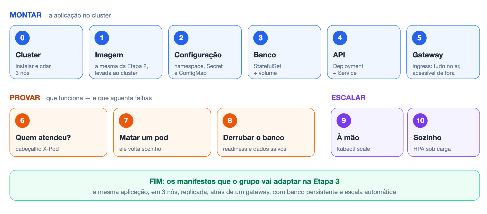
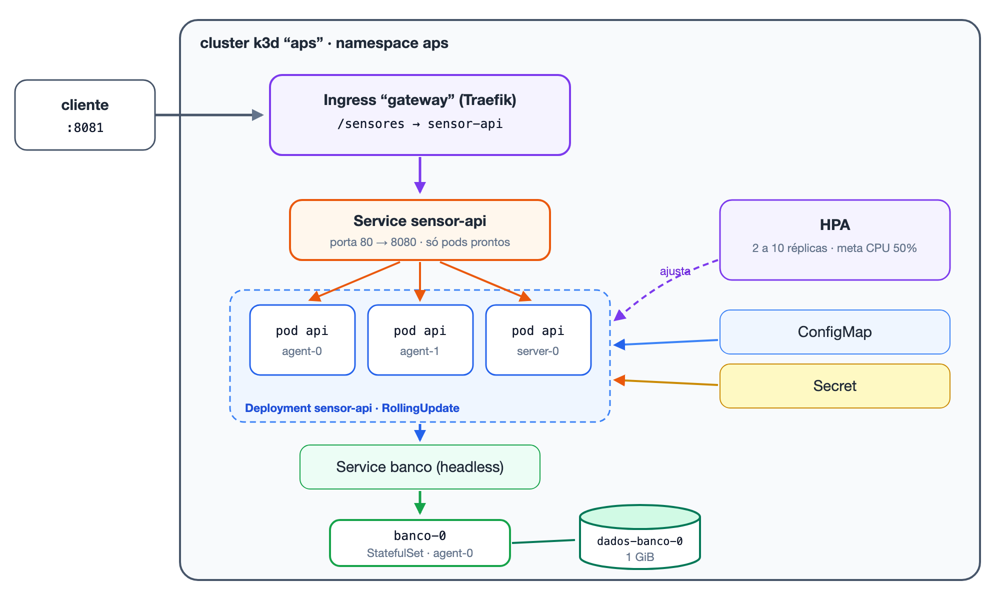

# Aula Prática 3 — Kubernetes: Deployment, Service, Ingress e HPA

**Disciplina:** Desenvolvimento de Sistemas Distribuídos (DSD) — UNIP, 2026.2
**Duração:** 1 aula (3 horas)
**Teoria:** `DSD.AulaTeorica4.Kubernetes.md` — os termos usados aqui estão explicados lá, e o glossário fica na seção 17
**Projeto de apoio:** `DSD.Projeto3.Kubernetes/`

---

## O que vamos fazer

Pegar a aplicação da Aula Prática 2 — a API de sensores e o banco PostgreSQL, que hoje sobem com `docker compose up` — e colocá-la num **cluster Kubernetes de três nós**, rodando no próprio notebook. Depois, provar na prática cada promessa da aula teórica: distribuição de carga, recuperação automática, tolerância à queda do banco e escala automática.

**Ao final da aula, vocês terão:**

- um cluster local com 3 nós, criado com o k3d;
- a API com 2 réplicas atrás de um gateway (Ingress), acessível em `http://localhost:8081/sensores`;
- o banco num StatefulSet, com dados que sobrevivem à destruição do pod;
- a senha fora da imagem e fora do Git (Secret), e a configuração num ConfigMap;
- um HPA aumentando e reduzindo as réplicas conforme a CPU;
- os manifestos (pasta `k8s/`) que servem de modelo para a **Etapa 3 da APS**.

---

## Pré-requisitos

### Conhecimento

- Ter lido a **Aula Teórica 4**, ao menos as seções 4 a 9.
- Ter feito a **Aula Prática 2** (Docker e Compose): saber construir uma imagem e subir a pilha.

### Máquina

| Item | Mínimo | Recomendado |
|---|---|---|
| Memória RAM | 8 GB | 16 GB |
| Núcleos de CPU | 4 | 8 |
| Disco livre | 5 GB | 10 GB |
| Porta livre | 8081 | — |

> Com 8 GB, feche o navegador com muitas abas e outros programas pesados. O cluster de 3 nós usa cerca de 2 GB.

### Software

| Programa | Para quê | Como instalar |
|---|---|---|
| **Docker Desktop** (ou Docker Engine no Linux) | Roda o cluster inteiro | Já instalado desde a Aula Prática 2 |
| **kubectl** | Falar com o cluster | Windows: vem com o Docker Desktop · macOS: `brew install kubectl` · Linux: [kubernetes.io/docs/tasks/tools](https://kubernetes.io/docs/tasks/tools/) |
| **k3d** (versão 5 ou superior) | Criar o cluster dentro do Docker | Windows: `choco install k3d` ou `scoop install k3d` · macOS: `brew install k3d` · Linux: `curl -s https://raw.githubusercontent.com/k3d-io/k3d/main/install.sh \| bash` |
| **Terminal bash** | Rodar os comandos da aula como estão escritos | Windows: **Git Bash** ou **WSL** · macOS/Linux: o terminal padrão |
| **curl** | Fazer requisições pelo terminal | Já vem com o Git Bash, o macOS e o Linux |

> **Windows:** rode os comandos desta aula no **Git Bash** ou no **WSL**. No PowerShell, `curl` é outro comando, e os laços `for` não funcionam como escritos. Instale o k3d no PowerShell **como administrador**; depois volte ao Git Bash.

### Confira o ambiente antes de começar

Com o Docker em execução:

```bash
docker version --format '{{.Server.Version}}'
kubectl version --client
k3d version
```

Os três precisam responder com uma versão. Se algum disser "comando não encontrado", resolva antes de seguir: os passos dependem dos três.

---

## O projeto de apoio

```text
DSD.Projeto3.Kubernetes/
├── Program.cs              ← a API da Prática 2, com 4 acréscimos (Passo 1)
├── Dockerfile              ← igual ao da Prática 2, mais a versão da imagem
├── docker-compose.yml      ← ainda funciona, para desenvolver sem cluster
├── .env.example            ← modelo das credenciais (copie para .env)
├── secret.example.yaml     ← modelo do Secret — documentação, NÃO é aplicado
└── k8s/                    ← os manifestos, aplicados em ordem alfabética
    ├── 00-namespace.yaml       a "pasta" aps
    ├── 01-configmap.yaml       configuração comum
    ├── 10-banco.yaml           Service headless + StatefulSet do PostgreSQL
    ├── 20-api.yaml             Deployment + Service da API
    ├── 30-ingress.yaml         o gateway
    └── 40-hpa.yaml             o autoescalonador
```

Os números no início dos nomes não são exigência do Kubernetes: servem para que `kubectl apply -f k8s/` aplique os arquivos numa ordem que faça sentido (primeiro a pasta, depois a configuração, o banco, a API, a entrada e a escala).

---

## O roteiro



Todos os comandos rodam **dentro da pasta `DSD.Projeto3.Kubernetes`**.

---

## Passo 0 — criar o cluster

**Objetivo:** ter três "máquinas" Kubernetes funcionando no notebook.

### O que fazer

Com o Docker em execução:

```bash
k3d cluster create aps --agents 2 -p "8081:80@loadbalancer"
kubectl get nodes
```

| Parte do comando | Significado |
|---|---|
| `aps` | Nome do cluster |
| `--agents 2` | Dois nós de trabalho, além do servidor: 3 nós no total |
| `-p "8081:80@loadbalancer"` | A porta 8081 da sua máquina chega à porta 80 do cluster, onde fica o Ingress |

A porta 8081 foi escolhida para não colidir com a 8080 da pilha Compose da Etapa 2. O k3d também configura o `kubectl` para falar com este cluster.

### O que você vai ver

```text
NAME               STATUS   ROLES           AGE   VERSION
k3d-aps-agent-0    Ready    <none>          23s   v1.35.5+k3s1
k3d-aps-agent-1    Ready    <none>          26s   v1.35.5+k3s1
k3d-aps-server-0   Ready    control-plane   34s   v1.35.5+k3s1
```

### ✔ Confira antes de seguir

- [ ] Três nós, todos `Ready`.
- [ ] `docker ps` mostra contêineres `k3d-aps-…`: cada nó é um contêiner.

### O que isso mostrou

Três "máquinas" prontas e nenhum serviço da APS ainda. O `server-0` roda o plano de controle (Teórica 4, seção 5); os dois `agent` são nós de trabalho.

---

## Passo 1 — construir a imagem e levá-la ao cluster

**Objetivo:** a mesma imagem da Etapa 2, com quatro acréscimos, disponível dentro do cluster.

### O que mudou no código

A API é a da Aula Prática 2. Os acréscimos estão em `Program.cs` e no `Dockerfile`:

| Acréscimo | Para quê |
|---|---|
| `PATH_BASE` + `UsePathBase` | O gateway encaminha `/sensores/...`; a API precisa aceitar esse prefixo |
| Cabeçalhos `X-Pod` e `X-Versao` | Cada resposta diz qual pod a atendeu e de qual versão — a evidência de balanceamento exigida pela APS |
| `/health/ready` com `SELECT 1` a cada chamada | Se o banco cair depois da partida, o pod sai do balanceamento (Passo 8) |
| Rota `/processar?n=` | Gasta CPU de propósito, para acionar o HPA (Passo 10) |

```csharp
// PREFIXO DO GATEWAY: o Ingress encaminha /sensores/... para este servico.
var prefixo = Environment.GetEnvironmentVariable("PATH_BASE");
if (!string.IsNullOrEmpty(prefixo))
    app.UsePathBase(prefixo);
app.UseRouting();

// EVIDENCIA DO BALANCEAMENTO: toda resposta informa qual pod a atendeu.
app.Use(async (contexto, proximo) =>
{
    contexto.Response.Headers["X-Pod"] = instancia;    // nome do pod
    contexto.Response.Headers["X-Versao"] = versao;    // versao da imagem
    await proximo();
});
```

### O que fazer

```bash
cd DSD.Projeto3.Kubernetes
docker build -t sensor-api:1.1.0 .
k3d image import sensor-api:1.1.0 -c aps
```

### ✔ Confira antes de seguir

- [ ] O `docker build` terminou sem erro.
- [ ] O `k3d image import` terminou com `Successfully imported 1 image(s) into 1 cluster(s)`.

### O que isso mostrou

O cluster **não enxerga** as imagens do seu Docker: cada nó tem o próprio depósito de imagens. Há dois caminhos para levá-las até lá:

| Caminho | Comando | Quando |
|---|---|---|
| Importar direto nos nós | `k3d image import` (ou `kind load`, `minikube image load`) | Cluster local — o que a APS permite |
| Publicar num registro | `docker push` para Docker Hub, GHCR etc. | Cluster em nuvem; pipeline de integração contínua (diferencial) |

É aqui que a **tag fixa** da Etapa 2 se paga: o manifesto pede `sensor-api:1.1.0`, e o rolling update vai pedir `1.2.0`. Com `latest` nos dois, o Kubernetes não perceberia diferença nenhuma.

---

## Passo 2 — Namespace, Secret e ConfigMap

**Objetivo:** criar a "pasta" da aplicação e colocar a configuração e a senha no cluster, fora da imagem.

### O que fazer

```bash
cp .env.example .env              # o mesmo .env da Etapa 2
kubectl apply -f k8s/00-namespace.yaml
kubectl create secret generic banco-credenciais -n aps --from-env-file=.env
```

O ConfigMap (`k8s/01-configmap.yaml`) será aplicado no Passo 5, junto com o resto. O conteúdo dele:

```yaml
apiVersion: v1
kind: ConfigMap
metadata:
  name: sensor-api-config
  namespace: aps
data:
  PATH_BASE: "/sensores"      # prefixo que o gateway usa
  BANCO_HOST: "banco"         # nome do Service do banco
```

Agora inspecione o Secret criado:

```bash
kubectl get secret banco-credenciais -n aps -o yaml
```

### O que você vai ver

```yaml
data:
  POSTGRES_DB: YW1iaWVudGFs
  POSTGRES_PASSWORD: dHJvcXVlLWVzdGEtc2VuaGE=
  POSTGRES_USER: c2Vuc29y
```

E a prova de que Base64 não esconde nada:

```bash
echo dHJvcXVlLWVzdGEtc2VuaGE= | base64 -d
# troque-esta-senha
```

### ✔ Confira antes de seguir

- [ ] `kubectl get namespace aps` mostra `Active`.
- [ ] `kubectl get secret -n aps` lista `banco-credenciais` com `DATA 3`.
- [ ] O arquivo `.env` **não** aparece no `git status` (está no `.gitignore`).

### O que isso mostrou

- O **namespace** `aps` agrupa tudo da aplicação; `kubectl delete namespace aps` apaga tudo de uma vez.
- O **Secret** foi criado a partir do `.env`, que não vai para o Git. O repositório leva só `secret.example.yaml`, com as **chaves** e valores fictícios — o mesmo papel do `.env.example`.
- **Base64 é codificação, não criptografia.** Quem tem permissão de ler o Secret lê a senha.

---

## Passo 3 — o banco: StatefulSet e volume

**Objetivo:** entender o manifesto do serviço **com estado**. Ainda não vamos aplicá-lo.

### O arquivo

`k8s/10-banco.yaml`, trechos principais:

```yaml
apiVersion: v1
kind: Service
metadata:
  name: banco
  namespace: aps
spec:
  clusterIP: None              # headless: nome DNS fixo, sem balanceamento
  selector:
    app: banco
  ports:
    - port: 5432
---
apiVersion: apps/v1
kind: StatefulSet
metadata:
  name: banco
  namespace: aps
spec:
  serviceName: banco
  replicas: 1
  ...
      containers:
        - name: postgres
          image: postgres:16-alpine
          envFrom:
            - secretRef:
                name: banco-credenciais        # usuário, senha e nome do banco
          volumeMounts:
            - name: dados
              mountPath: /var/lib/postgresql/data
          readinessProbe:
            exec:
              command: ["sh", "-c", "pg_isready -U \"$POSTGRES_USER\" -d \"$POSTGRES_DB\""]
  volumeClaimTemplates:                        # "um disco de 1 GiB para cada pod"
    - metadata:
        name: dados
      spec:
        accessModes: ["ReadWriteOnce"]
        resources:
          requests:
            storage: 1Gi
```

O `---` separa dois objetos no mesmo arquivo.

### Do Compose para o Kubernetes

| Compose (Etapa 2) | Kubernetes |
|---|---|
| `services: banco:` | `StatefulSet` + `Service` headless |
| `volumes: dados-postgres:` | `volumeClaimTemplates` → PVC `dados-banco-0` |
| `environment: POSTGRES_PASSWORD: ${...}` | `envFrom: secretRef` |
| `healthcheck: pg_isready` | `readinessProbe: exec: pg_isready` |

O nome DNS `banco` continua o mesmo do Compose — a string de conexão da API não muda.

---

## Passo 4 — a API: Deployment e Service

**Objetivo:** entender o manifesto do serviço **sem estado**, linha a linha. Também será aplicado no Passo 5.

### O arquivo

`k8s/20-api.yaml`:

```yaml
apiVersion: apps/v1
kind: Deployment
metadata:
  name: sensor-api
  namespace: aps
spec:
  replicas: 2
  selector:
    matchLabels:
      app: sensor-api
  strategy:
    type: RollingUpdate
    rollingUpdate:
      maxSurge: 1
      maxUnavailable: 0
  template:
    metadata:
      labels:
        app: sensor-api
    spec:
      containers:
        - name: api
          image: sensor-api:1.1.0
          imagePullPolicy: IfNotPresent
          ports:
            - containerPort: 8080
          envFrom:
            - configMapRef:
                name: sensor-api-config    # PATH_BASE, BANCO_HOST
            - secretRef:
                name: banco-credenciais    # POSTGRES_USER, _PASSWORD, _DB
          env:
            - name: CONNECTION_STRING
              value: "Host=$(BANCO_HOST);Username=$(POSTGRES_USER);Password=$(POSTGRES_PASSWORD);Database=$(POSTGRES_DB)"
          resources:
            requests: { cpu: 100m, memory: 96Mi }
            limits:   { cpu: 500m, memory: 256Mi }
          livenessProbe:
            httpGet: { path: /health/live, port: 8080 }
            initialDelaySeconds: 5
            periodSeconds: 10
            failureThreshold: 3
          readinessProbe:
            httpGet: { path: /health/ready, port: 8080 }
            periodSeconds: 5
            failureThreshold: 2
---
apiVersion: v1
kind: Service
metadata:
  name: sensor-api
  namespace: aps
spec:
  selector:
    app: sensor-api
  ports:
    - port: 80
      targetPort: 8080
```

### Lendo o arquivo, item por item

| Trecho | Função |
|---|---|
| `replicas: 2` | O estado desejado: duas cópias |
| `selector.matchLabels` = `template.metadata.labels` | É assim que o Deployment reconhece os **seus** pods. Se divergirem, o `apply` é recusado |
| `strategy` | Regras do rolling update: 1 pod a mais, nenhum a menos |
| `image: sensor-api:1.1.0` | Tag fixa. `imagePullPolicy: IfNotPresent` usa a imagem importada, sem tentar baixar da internet |
| `envFrom` | Todas as chaves do ConfigMap e do Secret viram variáveis de ambiente |
| `$(BANCO_HOST)` | Monta um valor a partir de variáveis já definidas |
| `resources` | Reserva e teto. Sem `requests`, o HPA do Passo 10 não funciona |
| `livenessProbe` | A cada 10 s; 3 falhas seguidas → reinicia o contêiner |
| `readinessProbe` | A cada 5 s; 2 falhas seguidas → pod sai do Service |
| `Service.spec.selector` | Envia tráfego a todo pod com `app: sensor-api` que esteja pronto |

---

## Passo 5 — tudo no ar, atrás do gateway

**Objetivo:** aplicar todos os manifestos e acessar a API pelo Ingress, de fora do cluster.

### O arquivo do gateway

`k8s/30-ingress.yaml`:

```yaml
apiVersion: networking.k8s.io/v1
kind: Ingress
metadata:
  name: gateway
  namespace: aps
spec:
  ingressClassName: traefik          # quem executa a regra
  rules:
    - http:
        paths:
          - path: /sensores          # tudo que começar com /sensores...
            pathType: Prefix
            backend:
              service:
                name: sensor-api     # ...vai para este Service
                port:
                  number: 80
```

### O que fazer

Aplique a pasta inteira e espere a API ficar pronta:

```bash
kubectl apply -f k8s/
kubectl rollout status deployment/sensor-api -n aps
kubectl get all,ingress,pvc,hpa -n aps -o wide
```

> O `apply` também cria o HPA (`40-hpa.yaml`). Ele só será usado no Passo 10; até lá, não atrapalha.

### O que você vai ver

```text
NAME                              READY   STATUS    RESTARTS   AGE   IP          NODE
pod/banco-0                       1/1     Running   0          28s   10.42.4.5   k3d-aps-agent-0
pod/sensor-api-7497b6f959-lcf9c   1/1     Running   0          28s   10.42.4.4   k3d-aps-agent-0
pod/sensor-api-7497b6f959-pz4mw   1/1     Running   0          28s   10.42.2.4   k3d-aps-agent-1

NAME                 TYPE        CLUSTER-IP     PORT(S)
service/banco        ClusterIP   None           5432/TCP
service/sensor-api   ClusterIP   10.43.254.37   80/TCP

NAME                         READY   UP-TO-DATE   AVAILABLE
deployment.apps/sensor-api   2/2     2            2

NAME                                CLASS     HOSTS   ADDRESS                            PORTS
ingress.networking.k8s.io/gateway   traefik   *       172.18.0.3,172.18.0.4,172.18.0.5   80

NAME                                  STATUS   CAPACITY   STORAGECLASS
persistentvolumeclaim/dados-banco-0   Bound    1Gi        local-path
```

> Nos primeiros segundos os pods da API podem aparecer como `0/1`: estão esperando o banco aceitar conexões. É a readiness funcionando.

Agora, pelo gateway:

```bash
curl -s http://localhost:8081/sensores/health/ready
curl -s -X POST http://localhost:8081/sensores/leituras \
     -H 'Content-Type: application/json' -d '{"estacao":"Ibirapuera","mp25":18.4}'
curl -s -X POST http://localhost:8081/sensores/leituras \
     -H 'Content-Type: application/json' -d '{"estacao":"Pinheiros","mp25":25.1}'
curl -s http://localhost:8081/sensores/leituras
curl -s -o /dev/null -w "%{http_code}\n" http://localhost:8081/leituras
```

```text
{"status":"ready","instancia":"sensor-api-7497b6f959-pz4mw"}
{"id":1,"estacao":"Ibirapuera","mp25":18.4,"registradoEm":"2026-10-09T16:27:03.825638Z"}
{"id":2,"estacao":"Pinheiros","mp25":25.1,"registradoEm":"2026-10-09T16:27:03.871463Z"}
[{"id":1,...},{"id":2,...}]
404
```

### ✔ Confira antes de seguir

- [ ] `banco-0` e os dois pods `sensor-api` estão `1/1 Running`.
- [ ] O PVC `dados-banco-0` está `Bound`.
- [ ] `curl .../sensores/health/ready` responde `"status":"ready"`.
- [ ] O `POST` devolveu a leitura com `id`.

### O que isso mostrou

- O scheduler colocou os pods da API em **nós diferentes**.
- `instancia` agora é o **nome do pod**, não mais o id do contêiner.
- `/leituras` sem o prefixo dá `404`: o Ingress só conhece `/sensores`. Com três serviços, cada um terá o seu prefixo — `/ingestao`, `/consulta`, `/alertas` — no **mesmo** Ingress.
- O prefixo chega inteiro à API (`/sensores/leituras`); o `UsePathBase` o remove antes de escolher a rota. A alternativa é o controlador remover o prefixo (no Traefik, um `Middleware` *StripPrefix*), mas isso amarra o manifesto a um controlador específico.

---

## Passo 6 — quem atendeu? (cabeçalho `X-Pod`)

**Objetivo:** provar, com evidência, que as requisições são distribuídas entre as réplicas.

### O que fazer

```bash
curl -si http://localhost:8081/sensores/health/live | grep -iE "^HTTP|x-pod|x-versao"

for i in $(seq 10); do
  curl -s -o /dev/null -D - http://localhost:8081/sensores/health/live | grep -i x-pod
done | sort | uniq -c
```

O laço faz 10 requisições, separa o cabeçalho `X-Pod` de cada uma e conta quantas vezes cada pod apareceu.

### O que você vai ver

```text
HTTP/1.1 200 OK
X-Pod: sensor-api-7497b6f959-pz4mw
X-Versao: 1.1.0

   5 X-Pod: sensor-api-7497b6f959-lcf9c
   5 X-Pod: sensor-api-7497b6f959-pz4mw
```

### ✔ Confira antes de seguir

- [ ] Os dois pods aparecem na contagem.

### O que isso mostrou

Dez requisições, cinco para cada réplica: o Traefik distribuiu em **rodízio** (*round-robin*), requisição a requisição — balanceamento de camada 7 (Teórica 4, seção 10). É o tipo de evidência que o documento da APS exige: "**em log ou em cabeçalho de resposta**, qual pod atendeu cada requisição". No gerador de carga da Etapa 4, guardem o `X-Pod` de cada resposta: com ele, a distribuição vira tabela e gráfico.

---

## Passo 7 — matar um pod

**Objetivo:** ver o laço de controle recriar sozinho um pod destruído.

### O que fazer

Em um terminal, deixe rodando:

```bash
kubectl get pods -n aps -l app=sensor-api -w
```

`-l app=sensor-api` filtra pelo rótulo; `-w` (*watch*) fica mostrando cada mudança. Em **outro** terminal, apague um dos pods da API (copie o nome da lista):

```bash
kubectl delete pod -n aps <nome-de-um-pod-da-api>
```

### O que você vai ver

```text
NAME                          READY   STATUS              RESTARTS   AGE
sensor-api-7497b6f959-5fz75   0/1     ContainerCreating   0          1s
sensor-api-7497b6f959-lcf9c   0/1     Completed           0          44s
sensor-api-7497b6f959-pz4mw   1/1     Running             0          44s
```

Cerca de 10 segundos depois:

```text
sensor-api-7497b6f959-5fz75   1/1     Running   0          13s
sensor-api-7497b6f959-pz4mw   1/1     Running   0          56s
```

Pare o acompanhamento com `Ctrl+C`.

### ✔ Confira antes de seguir

- [ ] Voltou a haver 2 pods `1/1`, um deles com nome novo.

### O que isso mostrou

Ninguém mandou criar o pod `5fz75`. O ReplicaSet viu 1 pod onde deveriam existir 2 e criou outro — o laço de controle (Teórica 4, seção 4). O pod novo tem **outro nome e outro IP**; o apagado não "voltou".

Repare no `0/1`: o pod novo existiu por alguns segundos **sem estar pronto**, e durante esse tempo o Service não lhe mandou requisições. Na Etapa 5 vocês vão medir quantas requisições falham nesse intervalo, com o gerador de carga rodando.

---

## Passo 8 — derrubar o banco

**Objetivo:** ver a readiness tirar a API do ar **sem reiniciá-la**, e os dados sobreviverem à destruição do pod do banco.

### O que fazer

Desligue o banco (zero réplicas):

```bash
kubectl scale statefulset banco -n aps --replicas=0
```

Espere uns 20 segundos e observe:

```bash
kubectl get pods -n aps
curl -s -o /dev/null -w "%{http_code}\n" http://localhost:8081/sensores/leituras
```

Depois traga o banco de volta:

```bash
kubectl scale statefulset banco -n aps --replicas=1
kubectl get pods -n aps -w          # Ctrl+C quando a API voltar a 1/1
curl -s http://localhost:8081/sensores/leituras
```

### O que você vai ver

Com o banco fora:

```text
NAME                          READY   STATUS    RESTARTS   AGE
sensor-api-7bf4fb6855-jwztt   0/1     Running   0          23s
sensor-api-7bf4fb6855-z4xfp   0/1     Running   0          22s

503
```

Com o banco de volta:

```text
NAME                          READY   STATUS    RESTARTS   AGE
banco-0                       1/1     Running   0          17s
sensor-api-7bf4fb6855-jwztt   1/1     Running   0          41s
sensor-api-7bf4fb6855-z4xfp   1/1     Running   0          40s

[{"id":1,"estacao":"Ibirapuera",...},{"id":2,"estacao":"Pinheiros",...}]
```

### ✔ Confira antes de seguir

- [ ] Com o banco fora: pods da API `0/1`, `RESTARTS 0`, gateway respondendo `503`.
- [ ] Com o banco de volta: as leituras criadas no Passo 5 continuam lá.

### O que isso mostrou

Este é o passo que justifica toda a discussão de probes (Teórica 4, seção 13):

- **`0/1 Running`, `RESTARTS 0`**: a readiness falhou, a liveness não. Os pods saíram do balanceamento **sem serem reiniciados**. O gateway, sem nenhum pod pronto, respondeu `503` — uma recusa limpa, em vez de um erro `500` de dentro da aplicação.
- Quando o banco voltou, a readiness passou e os pods **voltaram sozinhos** ao Service.
- **Os dados sobreviveram.** O pod `banco-0` foi destruído e recriado; o volume `dados-banco-0` não.

> **Por que a readiness precisou mudar.** No projeto da Etapa 2, `/health/ready` só verificava o banco **na partida**: uma vez pronto, respondia 200 para sempre. Testado no cluster, o resultado foi `ready = 200` com o banco desligado e `500` em `/leituras`. No Projeto 3 a readiness faz `SELECT 1` a cada verificação. **Confiram isso nos serviços do grupo.**

> **E a primeira requisição depois da volta?** As conexões que a API tinha guardadas no *pool* (o reservatório de conexões abertas) morreram com o banco. A primeira requisição de cada pod que tentar usar uma delas pode falhar com `terminating connection due to administrator command`. Repetir a operação depois de uma pequena espera (*retry*) é um dos padrões de resiliência valorizados no item II.5 da APS.

---

## Passo 9 — escalar à mão

**Objetivo:** aumentar o número de réplicas com um comando e ver o tráfego se espalhar.

### O que fazer

O HPA (criado no Passo 5) mantém o número de réplicas que **ele** calcula, e desfaria a escala manual. Remova-o antes:

```bash
kubectl delete hpa sensor-api -n aps
kubectl scale deployment sensor-api -n aps --replicas=4
kubectl get pods -n aps -l app=sensor-api -o wide

for i in $(seq 20); do
  curl -s -o /dev/null -D - http://localhost:8081/sensores/health/live | grep -i x-pod
done | sort | uniq -c
```

### O que você vai ver

```text
NAME                          READY   STATUS    NODE
sensor-api-7497b6f959-5fz75   1/1     Running   k3d-aps-agent-0
sensor-api-7497b6f959-85r9c   1/1     Running   k3d-aps-server-0
sensor-api-7497b6f959-pz4mw   1/1     Running   k3d-aps-agent-1
sensor-api-7497b6f959-rb8hp   1/1     Running   k3d-aps-agent-0

   7 X-Pod: sensor-api-7497b6f959-5fz75
   7 X-Pod: sensor-api-7497b6f959-pz4mw
   6 X-Pod: sensor-api-7497b6f959-rb8hp
```

### ✔ Confira antes de seguir

- [ ] 4 pods `1/1`, espalhados pelos nós.
- [ ] Repetindo o laço depois de alguns segundos, os 4 aparecem na contagem.

### O que isso mostrou

Quatro réplicas em segundos, espalhadas pelos três nós. Mas logo após a escala um dos pods ainda **não recebeu nenhuma** requisição: o gateway leva alguns segundos para incluir o pod novo. Repita o laço e ele aparece.

Esse atraso entre "pod pronto" e "pod recebendo tráfego" é um dos componentes do tempo de reação que a Etapa 5 pede para medir. É também o experimento obrigatório "escalabilidade horizontal manual" (1, 2, 4 e 8 réplicas), que será feito com o gerador de carga.

---

## Passo 10 — escalar sozinho: HPA

**Objetivo:** gerar carga de CPU e ver o HPA aumentar as réplicas sem intervenção.

### O arquivo

`k8s/40-hpa.yaml`:

```yaml
apiVersion: autoscaling/v2
kind: HorizontalPodAutoscaler
metadata:
  name: sensor-api
  namespace: aps
spec:
  scaleTargetRef:                # QUEM ele escala
    apiVersion: apps/v1
    kind: Deployment
    name: sensor-api
  minReplicas: 2                 # nunca menos que 2
  maxReplicas: 10                # nunca mais que 10
  metrics:
    - type: Resource
      resource:
        name: cpu
        target:
          type: Utilization
          averageUtilization: 50 # meta: 50% do requests, em média
```

### O que fazer

Recrie o HPA e confira que as métricas chegam:

```bash
kubectl apply -f k8s/40-hpa.yaml
kubectl top pod -n aps
```

Em um terminal, acompanhe o HPA:

```bash
kubectl get hpa -n aps -w
```

Em outro, gere carga por dois minutos e meio — seis laços em paralelo chamando a rota que gasta CPU (na Etapa 4, o gerador em Python substitui isto):

```bash
for w in 1 2 3 4 5 6; do
  ( fim=$((SECONDS+150))
    while [ $SECONDS -lt $fim ]; do
      curl -s -o /dev/null "http://localhost:8081/sensores/processar?n=2000000"
    done ) &
done
wait
```

### O que você vai ver

```text
NAME         REFERENCE               TARGETS        MINPODS   MAXPODS   REPLICAS
sensor-api   Deployment/sensor-api   cpu: 120%/50%  2         10        2
sensor-api   Deployment/sensor-api   cpu: 480%/50%  2         10        8
sensor-api   Deployment/sensor-api   cpu: 281%/50%  2         10        10
sensor-api   Deployment/sensor-api   cpu: 268%/50%  2         10        10
sensor-api   Deployment/sensor-api   cpu: 61%/50%   2         10        10
```

E o histórico de decisões:

```bash
kubectl describe hpa sensor-api -n aps
```

```text
Normal  SuccessfulRescale  2m48s  New size: 4;  reason: cpu resource utilization (percentage of request) above target
Normal  SuccessfulRescale  2m33s  New size: 8;  reason: cpu resource utilization (percentage of request) above target
Normal  SuccessfulRescale  2m18s  New size: 10; reason: cpu resource utilization (percentage of request) above target
```

Terminada a carga, espere uns 5 minutos: as réplicas voltam para 2.

### ✔ Confira

- [ ] `kubectl top pod` mostra números (e não erro).
- [ ] A coluna `REPLICAS` do HPA subiu durante a carga.
- [ ] `kubectl describe hpa` mostra eventos `SuccessfulRescale`.

> **`<unknown>/50%` no começo?** É normal nos primeiros 30 a 60 segundos depois de criar o HPA: o metrics-server ainda não coletou. Se continuar depois disso, falta `requests` de CPU no Deployment.

### O que isso mostrou

- O HPA foi de 2 para 10 réplicas em **30 segundos**, em três decisões (4, 8, 10). A cada decisão ele pode, no máximo, dobrar o número de réplicas (ou somar 4, o que for maior).
- **Com 10 réplicas, a CPU continuou em 268%.** Mais pods não resolveram, porque o limite deixou de ser o pod e passou a ser **a máquina**: os 10 pods disputam os mesmos núcleos do notebook. É a Lei de Amdahl e o limite da máquina hospedeira — exatamente a discussão que o documento da APS pede no experimento de escalabilidade.
- Para **reduzir**, o HPA espera 5 minutos de estabilização: subir rápido e descer devagar evita oscilação.

---

## Fim do laboratório — o que vocês têm agora



Para limpar (quando terminar a aula):

```bash
kubectl delete namespace aps     # apaga a aplicação, inclusive o volume
k3d cluster delete aps           # apaga o cluster
```

Para pausar sem apagar (e continuar em casa): `k3d cluster stop aps` e, depois, `k3d cluster start aps`.

---

# FECHAMENTO

## Uma prévia da Etapa 5: o rolling update

O Deployment já está configurado para atualização sem interrupção. Uma rodada rápida, com tráfego contínuo:

```bash
docker build --build-arg VERSAO=1.2.0 -t sensor-api:1.2.0 .
k3d image import sensor-api:1.2.0 -c aps

kubectl set image deployment/sensor-api -n aps api=sensor-api:1.2.0
kubectl rollout status deployment/sensor-api -n aps
kubectl rollout undo deployment/sensor-api -n aps          # volta para a 1.1.0
```

No teste feito na preparação desta aula, com 3 réplicas e requisições contínuas durante a troca, foram **685 requisições: 684 com `200` e 1 com `504`**, e o cabeçalho `X-Versao` passou de `1.1.0` para `1.2.0` no meio da sequência.

Uma falha em 685 não é zero. O pod antigo recebeu o sinal de encerramento enquanto o gateway ainda lhe enviava uma requisição. Explicar esse resultado e eliminá-lo (`preStop` com espera, encerramento gracioso) é exatamente o tipo de análise que vale nota na Etapa 5: **resultado ruim explicado não reduz a nota; resultado não explicado, sim.**

---

## Colinha de comandos

```bash
# ---------- CLUSTER (k3d) ----------
k3d cluster create aps --agents 2 -p "8081:80@loadbalancer"
k3d cluster list / stop aps / start aps / delete aps
k3d image import nome:tag -c aps

# ---------- APLICAR E VER ----------
kubectl apply -f k8s/                       # aplica (cria ou atualiza) tudo
kubectl get all -n aps                      # visao geral
kubectl get pods -n aps -o wide             # em qual no esta cada pod
kubectl get pods -n aps -w                  # acompanhar mudancas
kubectl describe pod <pod> -n aps           # eventos: o PRIMEIRO lugar para olhar quando algo falha
kubectl logs <pod> -n aps                   # logs do conteiner
kubectl logs -f deploy/sensor-api -n aps    # logs de um pod do deployment
kubectl exec -it <pod> -n aps -- sh         # shell dentro do pod

# ---------- ESCALA, HPA, METRICAS ----------
kubectl scale deployment sensor-api -n aps --replicas=4
kubectl get hpa -n aps -w
kubectl top pod -n aps
kubectl top node

# ---------- ATUALIZACAO ----------
kubectl set image deployment/sensor-api -n aps api=sensor-api:1.2.0
kubectl rollout status deployment/sensor-api -n aps
kubectl rollout history deployment/sensor-api -n aps
kubectl rollout undo deployment/sensor-api -n aps
kubectl rollout restart deployment/sensor-api -n aps

# ---------- CONFIGURACAO ----------
kubectl create secret generic banco-credenciais -n aps --from-env-file=.env
kubectl get configmap,secret -n aps

# ---------- FALHAS (Etapa 5) ----------
kubectl delete pod <pod> -n aps
kubectl drain k3d-aps-agent-1 --ignore-daemonsets --delete-emptydir-data
kubectl uncordon k3d-aps-agent-1

# ---------- LIMPEZA ----------
kubectl delete namespace aps
```

---

## Erros comuns

| Sintoma | Causa | Correção |
|---|---|---|
| `k3d cluster create` falha | Docker parado, ou porta 8081 ocupada | Iniciar o Docker; trocar a porta (`-p "8082:80@loadbalancer"`) |
| `ErrImagePull` / `ImagePullBackOff` | Imagem não importada no cluster, ou tag diferente da do manifesto | `k3d image import nome:tag -c aps`; conferir a tag |
| `CrashLoopBackOff` | O processo morre ao iniciar — variável faltando, dependência indisponível | `kubectl logs <pod> --previous`; nova tentativa com espera no código |
| `CreateContainerConfigError` | Secret ou ConfigMap referenciado não existe | `kubectl get secret,configmap -n aps`; criar o Secret do Passo 2 |
| Pod `0/1 Running` para sempre | Readiness falhando | `kubectl describe pod` mostra a probe; testar a rota com `kubectl exec` |
| `RESTARTS` subindo sem parar | Liveness falhando — ou verificando o banco | Liveness só verifica o processo |
| `OOMKilled` | Passou do `limits.memory` | Aumentar o limite ou investigar consumo |
| Pod `Pending` | Nenhum nó com recurso livre para o `requests` | `kubectl describe pod`; reduzir `requests` ou réplicas |
| HPA com `<unknown>` | Sem `requests` de CPU, ou metrics-server ainda coletando | Declarar `requests`; esperar 1 minuto |
| `kubectl scale` "não funciona" | O HPA desfaz a escala manual | `kubectl delete hpa` durante o experimento manual |
| `404` pelo gateway | Caminho fora das regras do Ingress, ou API sem tratar o prefixo | Conferir `path` do Ingress e o `PATH_BASE` |
| `503` pelo gateway | Nenhum pod pronto no Service | `kubectl get pods`; ver a readiness |
| Dados somem | Banco em Deployment sem volume | StatefulSet com `volumeClaimTemplates` |
| Senha no repositório | Secret com valores reais versionado | Versionar só `secret.example.yaml`; criar o real a partir do `.env` |

---

## O que vocês farão na Etapa 3 da APS

Repetir os passos 0 a 10 **com os três serviços do grupo**, as imagens da Etapa 2, o banco, o cache e a fila.

### Requisitos da entrega

1. **Pasta `k8s/` no repositório** com os manifestos de toda a aplicação, aplicáveis com `kubectl apply -f k8s/`.
2. **Um Deployment e um Service por serviço** (mínimo 3), com:
   - imagem com tag fixa;
   - `requests` e `limits` de CPU e memória;
   - `livenessProbe` e `readinessProbe` distintas — a readiness verificando as dependências **a cada chamada**;
   - estratégia `RollingUpdate`.
3. **Ingress** como gateway único, roteando **por caminho** para os três serviços.
4. **ConfigMap** com a configuração comum e **Secret** com as credenciais — o Secret real criado a partir do `.env`; o repositório leva só o modelo.
5. **StatefulSet** (ou PVC) para o banco, com dados que sobrevivem à exclusão do pod.
6. **Cache e fila** no cluster (Redis, RabbitMQ etc.), também com Service.
7. **HPA** para o serviço de ingestão: mínimo 2, máximo 10, CPU.
8. **metrics-server** respondendo: `kubectl top pod` funciona.
9. **Evidência de balanceamento**: cada serviço informa, em cabeçalho ou log, o pod que atendeu.
10. **Cliente leve** acessando a aplicação **pelo Ingress**.
11. **README** com os comandos para construir e importar as imagens e subir tudo do zero.

### Como será verificado

Em um cluster recém-criado, com o repositório recém-clonado:

```bash
k3d cluster create aps --agents 2 -p "8081:80@loadbalancer"
# construir e importar as imagens (documentado no README do grupo)
cp .env.example .env
kubectl apply -f k8s/00-namespace.yaml
kubectl create secret generic <nome> -n aps --from-env-file=.env
kubectl apply -f k8s/
```

Em seguida, durante a aula, a banca vai pedir para:

- abrir o cliente pelo endereço do Ingress;
- mostrar o `X-Pod` alternando;
- apagar um pod de qualquer serviço e mostrar o novo ficando pronto;
- escalar um serviço para 4 réplicas.

A ficha de acompanhamento (`APS.2026.Ficha.Acompanhamento.Etapa3.Kubernetes.pdf`) traz o checklist completo.

### Registrem as evidências para o relatório

- saída de `kubectl get all,ingress,pvc,hpa -n aps -o wide` com a aplicação completa **(Passo 5)**
- distribuição das requisições por pod (`X-Pod`) **(Passo 6)**
- linha do tempo de um pod apagado até o substituto ficar `1/1` **(Passo 7)**
- pods `0/1` com `RESTARTS 0` durante a queda do banco e os dados preservados depois **(Passo 8)**
- saída de `kubectl top pod` **(Passo 10)**
- eventos do HPA (`kubectl describe hpa`) com as decisões de escala **(Passo 10)**
- o diagrama de implantação: quais pods, em quais nós, ligados por quais Services (exigido no relatório final)

---

## Referências

- **Aula Teórica 4** — *Kubernetes: orquestração de contêineres* (`DSD.AulaTeorica4.Kubernetes.md`)
- **Documento da APS 2026** — *Infraestrutura Distribuída*, itens II.2, II.3, II.4 e II.6
- THE KUBERNETES AUTHORS. *Kubernetes Documentation* — [Deployments](https://kubernetes.io/docs/concepts/workloads/controllers/deployment/), [Service](https://kubernetes.io/docs/concepts/services-networking/service/), [Ingress](https://kubernetes.io/docs/concepts/services-networking/ingress/), [HorizontalPodAutoscaler](https://kubernetes.io/docs/tasks/run-application/horizontal-pod-autoscale/), [kubectl Quick Reference](https://kubernetes.io/docs/reference/kubectl/quick-reference/)
- k3d — [Documentação](https://k3d.io)
