# Aula Teórica 4 — Kubernetes: orquestração de contêineres

**Disciplina:** Desenvolvimento de Sistemas Distribuídos (DSD) — UNIP, 2026.2
**Aula prática correspondente:** `DSD.AulaPratica3.Kubernetes.md`
**Relação com a APS:** base conceitual da **Etapa 3** (implantação em Kubernetes)

> **Como ler esta aula.** Nenhuma palavra nova aparece sem explicação. A seção 3 revisa os termos que vêm de aulas anteriores; a partir daí, cada conceito do Kubernetes é apresentado em três camadas: **a ideia** em linguagem do dia a dia, **a imagem** que a resume e **o detalhe técnico** que vocês vão usar no laboratório e no relatório. No fim há um **glossário** com todos os termos, em ordem alfabética.

---

## Sumário

1. [Por que esta aula](#1-por-que-esta-aula)
2. [O que é o Kubernetes](#2-o-que-é-o-kubernetes)
3. [Palavras que vamos usar o tempo todo](#3-palavras-que-vamos-usar-o-tempo-todo)
4. [A ideia central: estado desejado](#4-a-ideia-central-estado-desejado)
5. [As peças de um cluster](#5-as-peças-de-um-cluster)
6. [Pod: a menor unidade](#6-pod-a-menor-unidade)
7. [Namespace e rótulos: organizar e encontrar](#7-namespace-e-rótulos-organizar-e-encontrar)
8. [Deployment e ReplicaSet: manter cópias](#8-deployment-e-replicaset-manter-cópias)
9. [Service: um endereço que não muda](#9-service-um-endereço-que-não-muda)
10. [Ingress: a porta de entrada](#10-ingress-a-porta-de-entrada)
11. [ConfigMap e Secret: configuração fora da imagem](#11-configmap-e-secret-configuração-fora-da-imagem)
12. [StatefulSet e volume: o serviço que guarda dados](#12-statefulset-e-volume-o-serviço-que-guarda-dados)
13. [Probes: liveness e readiness](#13-probes-liveness-e-readiness)
14. [Requests, limits e HPA](#14-requests-limits-e-hpa)
15. [Rolling update: trocar de versão sem parar](#15-rolling-update-trocar-de-versão-sem-parar)
16. [Resumo](#16-resumo)
17. [Glossário](#17-glossário)

---

## 1. Por que esta aula

Na Etapa 2 da APS cada grupo colocou seus serviços dentro de **contêineres** e subiu a aplicação inteira com um comando: `docker compose up`.

O Compose é ótimo para **ligar** a aplicação. Mas ele não **toma conta** dela depois de ligada. A Aula Prática 2 terminou mostrando isso: `docker compose up --scale api=3` falha, e mesmo que funcionasse, faltariam quatro coisas:

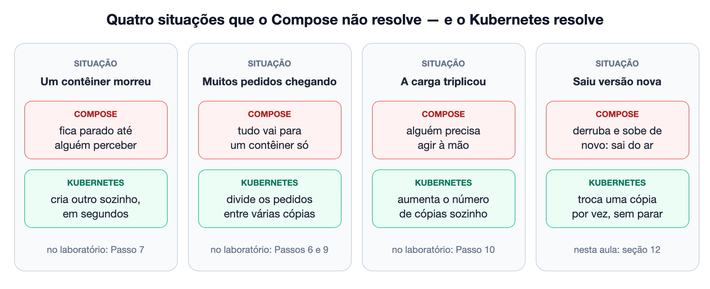

Essas quatro situações são, uma a uma, os **experimentos obrigatórios da APS**. A ferramenta que as resolve é o **Kubernetes**.

**Onde esta aula se encaixa na APS:**

| Etapa | Conteúdo |
|---|---|
| 1 ✅ | Serviços / APIs com contrato explícito |
| 2 ✅ | Docker: imagens e pilha local com Compose |
| **3 ← esta aula** | **Kubernetes: Deployment, Service, Ingress, HPA** |
| 4 | Gerador de carga em Python e linha de base |
| 5 | Experimentos de escalabilidade e resiliência |
| 6 | Relatório e apresentação |

---

## 2. O que é o Kubernetes

### Em uma frase

O **Kubernetes** é um **orquestrador de contêineres**: um sistema que administra, sozinho e continuamente, muitos contêineres espalhados por várias máquinas.

### O que é "orquestrar"

Pensem num maestro. Ele não toca nenhum instrumento; ele decide **quem** toca, **quando** e **quanto**, e corrige quem sai do tempo. Um **orquestrador** faz o mesmo com contêineres:

| O orquestrador decide… | Exemplo |
|---|---|
| **quantos** contêineres de cada tipo devem existir | "3 cópias da API, 1 do banco" |
| **em qual máquina** cada um roda | "esta máquina tem memória sobrando; coloque aqui" |
| **para qual deles** vai cada requisição | "esta vai para a cópia 2" |
| **o que fazer quando algo quebra** | "a cópia 1 morreu; crie outra" |
| **como trocar de versão** | "troque uma cópia por vez" |

Sem orquestrador, cada uma dessas decisões é tarefa de uma pessoa, digitando comandos e vigiando telas. Com cinco contêineres isso é possível; com quinhentos, não.

### De onde veio

- O Google roda seus serviços em contêineres há mais de quinze anos, com um sistema interno chamado **Borg**.
- Em **2014** engenheiros do Google lançaram o Kubernetes como projeto de **código aberto**, inspirado no Borg.
- Em 2015 o projeto foi doado à **CNCF** (*Cloud Native Computing Foundation*), uma fundação neutra. Hoje ele é mantido por milhares de pessoas e empresas, e é o padrão de mercado para rodar contêineres em produção.
- O nome vem do grego *kubernḗtēs*, "timoneiro" — quem conduz o navio. Por isso o logotipo é um **leme**. É comum ver a abreviação **K8s**: o K, as 8 letras do meio e o s.

### Onde ele roda

O Kubernetes é um **software**, e existem várias **distribuições** dele — versões empacotadas por empresas ou comunidades, como as distribuições do Linux:

| Onde                    | Exemplos                                      | Quem cuida do cluster                                |
| ----------------------- | --------------------------------------------- | ---------------------------------------------------- |
| Nuvem (gerenciado)      | Amazon **EKS**, Azure **AKS**, Google **GKE** | O provedor cuida do "cérebro"; vocês, das aplicações |
| Servidores próprios     | Kubernetes "puro", OpenShift, Rancher         | A equipe da empresa                                  |
| Notebook, para aprender | **k3d**, kind, minikube, Docker Desktop       | Vocês                                                |

Na APS vamos usar o **k3d**, que monta um cluster de várias "máquinas" dentro do próprio notebook. Como isso é possível — e por que importa para os experimentos — fica para o fim da seção 5, depois que as peças de um cluster estiverem explicadas.

### O que o Kubernetes **não** é

- **Não substitui o Docker.** Continuamos usando as mesmas imagens da Etapa 2; o Dockerfile não muda. O que muda é **quem decide** quantos contêineres existem, onde rodam e quem atende cada requisição.
- **Não torna o código escalável sozinho.** Se a aplicação guarda estado na memória ou depende de um banco lento, mais cópias não resolvem. O Kubernetes multiplica o que vocês construíram — inclusive os defeitos.
- **Não é obrigatório para todo projeto.** Para um sistema pequeno, numa máquina, o Compose basta. O Kubernetes se paga quando há várias máquinas, várias cópias e exigência de ficar no ar.

---

## 3. Palavras que vamos usar o tempo todo

Estes termos vêm das aulas anteriores (Docker, redes, APIs). Como aparecem em quase toda frase daqui em diante, vale revisá-los antes.

### Sobre contêineres

| Termo | O que é |
|---|---|
| **Imagem** | O "molde" de um programa: o código já compilado mais tudo de que ele precisa para rodar. É um arquivo; não executa nada sozinho. |
| **Tag** | A etiqueta de versão de uma imagem: em `sensor-api:1.1.0`, a tag é `1.1.0`. |
| **Contêiner** | Uma imagem **em execução**: um processo isolado, criado a partir do molde. De uma imagem podem nascer muitos contêineres iguais. |
| **Registro de imagens** | Um "depósito" de imagens na internet (Docker Hub, GitHub Container Registry), de onde as máquinas as baixam. |
| **Processo** | Um programa em execução no sistema operacional. |

### Sobre máquinas e recursos

| Termo | O que é |
|---|---|
| **Máquina** / **host** | Um computador — físico ou virtual — que executa os contêineres. |
| **CPU** e **núcleo** | O processador e cada uma de suas unidades de processamento. Um notebook típico tem de 4 a 16 núcleos. |
| **Memória** (RAM) | O espaço de trabalho dos programas em execução; acaba quando a máquina desliga. |
| **Disco** / **volume** | Armazenamento que **sobrevive** ao desligamento; é onde o banco grava os dados. |

### Sobre rede

| Termo | O que é |
|---|---|
| **Endereço IP** | O "endereço de casa" de uma máquina ou contêiner na rede, como `10.42.4.4`. |
| **Porta** | O "número do apartamento" dentro daquele endereço: identifica qual programa recebe a conexão (`8080`, `5432`). |
| **DNS** | O serviço que traduz **nomes** em endereços IP — como uma agenda de contatos. É o que permite escrever `banco` em vez de `10.42.4.5`. |
| **TCP** | O protocolo que estabelece uma **conexão** confiável entre dois programas. Funciona na **camada 4** (transporte) do modelo TCP/IP (Aula Teórica 3). |
| **HTTP** | O protocolo das **requisições** web (GET, POST…), que viaja **dentro** de uma conexão TCP. Funciona na **camada 7** (aplicação). |
| **Requisição** | Um pedido HTTP a uma API: um verbo, uma URL, cabeçalhos e, às vezes, um corpo. |
| **Cabeçalho** (*header*) | Informação extra que vai junto da requisição ou da resposta, como `Content-Type: application/json`. |
| **Proxy reverso** | Um programa que recebe requisições na frente de outros e as repassa a eles — o "recepcionista" da aplicação. |

### Sobre sistemas distribuídos

| Termo | O que é |
|---|---|
| **Réplica** | Uma cópia idêntica de um serviço rodando ao mesmo tempo que as outras. |
| **Balanceamento de carga** | Distribuir as requisições entre as réplicas, para nenhuma ficar sobrecarregada. |
| **Escalar verticalmente** | Dar **mais recursos** a uma mesma máquina (mais CPU, mais memória). |
| **Escalar horizontalmente** | Colocar **mais réplicas** lado a lado. É o que o Kubernetes facilita. |
| **Sem estado** (*stateless*) | Serviço que não guarda nada consigo entre uma requisição e outra; qualquer réplica atende qualquer pedido. |
| **Com estado** (*stateful*) | Serviço que guarda dados que não podem se perder — como um banco de dados. |
| **Health check** | Uma rota (como `/health/live`) que responde se o serviço está saudável. |

### Sobre ferramentas

| Termo | O que é |
|---|---|
| **Linha de comando** / **terminal** | A janela onde se digitam comandos (`docker`, `kubectl`, `curl`). |
| **Variável de ambiente** | Um valor que o sistema entrega ao programa quando ele inicia (`BANCO_HOST=banco`). É como a aplicação recebe configuração sem mudar o código. |
| **YAML** | Um formato de texto para descrever dados usando **indentação** (espaços) — o mesmo do `docker-compose.yml`. Os arquivos do Kubernetes são escritos nele. |

---

## 4. A ideia central: estado desejado

### A ideia

Existem duas formas de pedir algo a alguém:

- **dando ordens** — "liga o servidor A, depois copia o arquivo, depois reinicia o B". Se algo der errado no meio, quem pediu precisa perceber e corrigir. É o estilo **imperativo**;
- **descrevendo o resultado** — "quero 3 cópias da API funcionando". Quem recebe o pedido descobre sozinho o que fazer, agora e sempre. É o estilo **declarativo**.

O Kubernetes trabalha **do segundo jeito**. Vocês escrevem um arquivo dizendo **o que** deve existir — o **manifesto**. O cluster (o conjunto de máquinas, seção 5) guarda esse pedido como **estado desejado** e, a partir daí, fica o tempo todo comparando o que foi pedido com o que realmente existe — o **estado atual** — e corrigindo a diferença. Na figura, cada caixinha **pod** é uma cópia em execução da aplicação — o termo exato vem na seção 6:

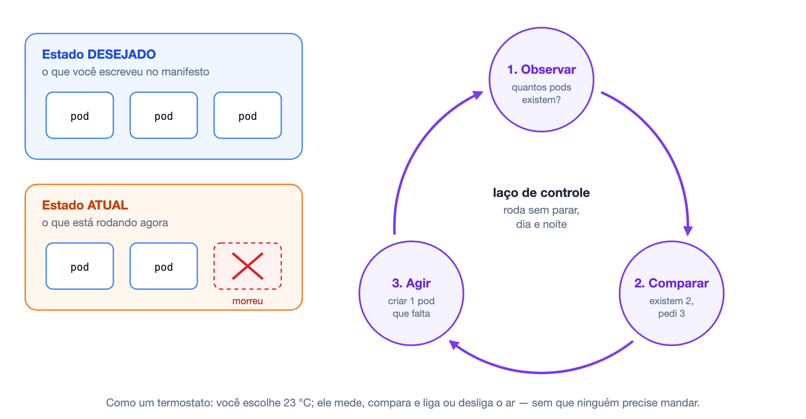

Esse ciclo se chama **laço de controle** (*reconciliation loop*, "laço de reconciliação") e é **a ideia mais importante da aula**. Quase tudo o que vocês verão no laboratório é consequência dele:

| O que aconteceu | O que o laço percebe | O que ele faz |
|---|---|---|
| Uma cópia da API morreu | Existem 2, o pedido é 3 | Cria outra |
| Vocês trocaram a versão para `1.2.0` | As cópias existentes são da versão antiga | Troca uma por uma |
| O autoescalonador viu CPU alta (seção 14) | Ele **mudou o pedido** para 6 | Cria as que faltam |

Ninguém mandou "reinicie aquela cópia". Vocês só declararam o que queriam; o cluster persegue isso indefinidamente.

### Como é um manifesto

Todo manifesto do Kubernetes tem o mesmo esqueleto, em YAML:

```yaml
apiVersion: apps/v1        # qual "versão do formulário" está sendo usada
kind: Deployment           # QUE TIPO de coisa estou pedindo
metadata:
  name: sensor-api         # o NOME dela
  namespace: aps           # em qual "pasta" do cluster ela fica (seção 7)
spec:                      # COMO eu quero que ela seja  ← o estado desejado
  replicas: 3
  ...
```

Quatro perguntas: **que formulário, que tipo, qual nome, como quero**. Cada coisa que se pede ao Kubernetes — um Deployment, um Service, um Secret — é chamada de **objeto** ou **recurso**, e o campo `kind` diz qual é o tipo.

### O kubectl

Para entregar o manifesto ao cluster, usa-se o **kubectl** (pronuncia-se "cube control"), o programa de linha de comando do Kubernetes. Ele é para o Kubernetes o que o comando `docker` é para o Docker:

```bash
kubectl apply -f arquivo.yaml     # "este é o estado que eu quero"  (cria ou atualiza)
kubectl get pods                  # "mostre o estado atual"
kubectl describe pod <nome>       # "conte em detalhe o que aconteceu com este"
kubectl delete -f arquivo.yaml    # "não quero mais isto"
```

---

## 5. As peças de um cluster

### A ideia

Até agora tudo rodava **em uma máquina só**. O Kubernetes junta **várias máquinas** e as faz parecer um computador único. Esse conjunto se chama **cluster** ("aglomerado"), e cada máquina dele é um **nó** (*node*).

Os nós têm dois papéis. Uma parte do cluster **pensa** e outra **trabalha**:

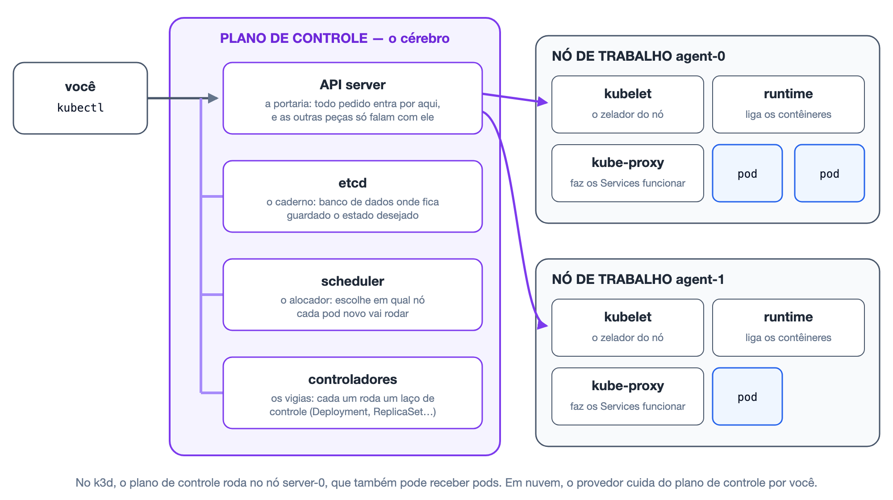

### O cérebro: o plano de controle

O **plano de controle** (*control plane*) guarda os pedidos e toma as decisões. São quatro peças:

| Peça | Papel | Analogia |
|---|---|---|
| **API server** | A entrada única do cluster. Recebe os comandos do `kubectl`, confere se estão corretos e é o único que fala com o etcd. As outras peças conversam **só** com ele. | A portaria |
| **etcd** | Um banco de dados pequeno e muito confiável onde fica gravado o estado desejado. Se ele se perder, o cluster "esquece" tudo o que foi pedido. | O caderno de anotações |
| **scheduler** | Escolhe **em qual nó** cada contêiner novo vai rodar, conforme a memória e a CPU disponíveis. | O alocador de mesas |
| **controladores** | Pequenos programas que executam os laços de controle da seção 4 — um para cada tipo de objeto. | Os vigias |

### Os braços: os nós de trabalho

Cada **nó de trabalho** executa os contêineres de fato. Nele rodam três peças:

| Peça | Papel |
|---|---|
| **kubelet** | O "zelador" do nó. Pergunta ao API server o que deve rodar ali, manda ligar os contêineres e verifica periodicamente se estão saudáveis. |
| **runtime de contêiner** | O programa que efetivamente cria os contêineres a partir das imagens (no k3s, o **containerd** — o mesmo motor usado pelo Docker). |
| **kube-proxy** | Configura a rede do nó para que os **Services** (seção 9) funcionem. |

### Juntando tudo: o caminho de um pedido

Vale acompanhar uma vez o que acontece entre digitar o comando e a aplicação responder:

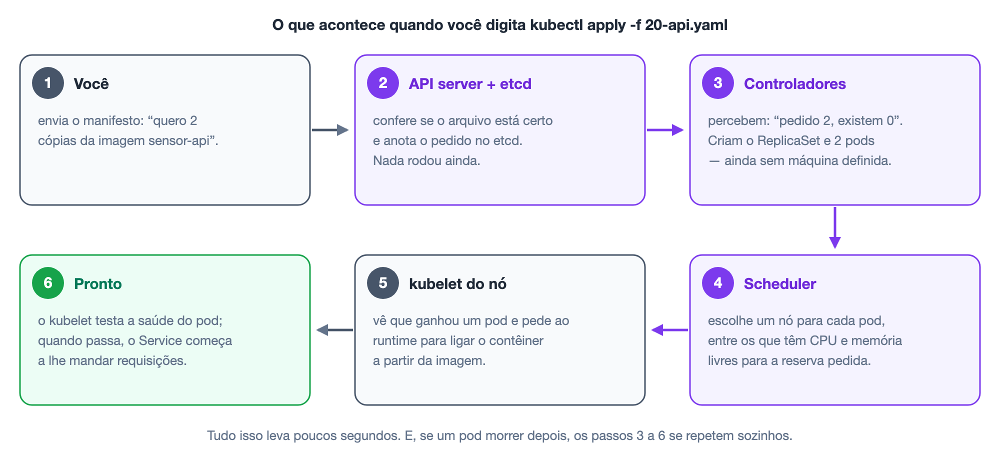

Repare que **ninguém dá ordens diretas**: cada peça observa o API server, percebe que há algo a fazer na sua área e faz. É o laço de controle, repetido em cada peça.

### O cluster da APS: k3s e k3d

#### O problema

Um cluster de verdade tem várias máquinas — numa empresa, três servidores no mínimo. A APS pede experimentos que só fazem sentido com mais de uma máquina: distribuir pods entre nós, derrubar um nó e ver a aplicação sobreviver. Mas cada grupo tem um notebook. Como ter três máquinas num computador só?

#### A solução, em duas peças

| Peça | O que é |
|---|---|
| **k3s** | Uma **distribuição** do Kubernetes (seção 2) feita para ser leve: um único programa, de cerca de 70 MB, que contém todas as peças desta seção — plano de controle, kubelet, containerd — e ainda traz prontos o controlador de entrada (Traefik, seção 10), o medidor de CPU (metrics-server, seção 14) e um criador de discos (`local-path`, seção 12). Ele roda em dois **modos**: **servidor**, que inclui o plano de controle, e **agente**, só com as peças de nó de trabalho. É Kubernetes de verdade, certificado pela CNCF — os mesmos manifestos funcionam num cluster de nuvem. |
| **k3d** | Uma ferramenta (o nome vem de "**k3s** in **d**ocker") que cria **contêineres Docker** e roda o k3s dentro de cada um. Cada contêiner faz o papel de uma máquina. |

Ou seja: o k3d **não simula** o Kubernetes. Ele simula as **máquinas**. O Kubernetes que roda dentro delas é o real.

#### Como fica montado

Um único comando — `k3d cluster create aps --agents 2 -p "8081:80@loadbalancer"` — cria quatro contêineres no Docker do notebook:

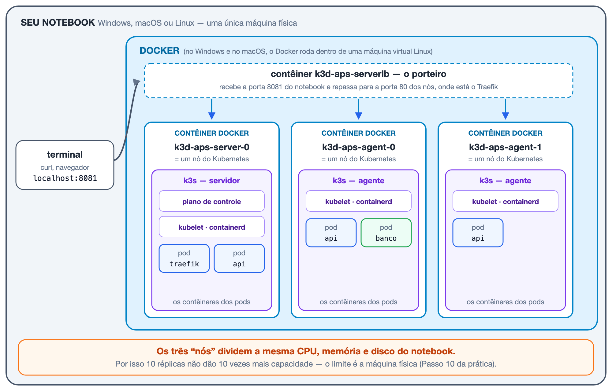

Lendo a figura de fora para dentro:

1. **O notebook** é a única máquina física. Tudo o que está na figura divide a CPU e a memória dele.
2. **O Docker** roda nele, como na Etapa 2. No Windows e no macOS, o Docker já funciona dentro de uma máquina virtual Linux — mais uma camada, invisível para vocês.
3. **Três contêineres fazem o papel de nós.** `k3d-aps-server-0` roda o k3s no modo servidor (o "cérebro" da seção 5 está aqui) e também recebe pods; `k3d-aps-agent-0` e `k3d-aps-agent-1` rodam o k3s no modo agente. Para o Kubernetes, são três máquinas diferentes, cada uma com nome, endereço IP e kubelet próprios.
4. **Os pods rodam dentro dos nós.** Pod é o nome que o Kubernetes dá a cada cópia em execução da aplicação (seção 6). O containerd de cada nó cria os contêineres dos pods **dentro** do contêiner-nó. São contêineres dentro de contêineres — como as bonecas russas que se encaixam umas nas outras.
5. **Um quarto contêiner, `k3d-aps-serverlb`, é o porteiro.** É ele que liga a porta 8081 do notebook (`-p "8081:80@loadbalancer"`) à porta 80 dos nós, onde o Traefik espera as requisições. Por isso, no laboratório, tudo é acessado em `localhost:8081`.

Depois de criar o cluster, `docker ps` mostra exatamente esses quatro contêineres — e `kubectl get nodes` mostra três nós. É a mesma coisa vista de dois andares diferentes.

#### O que é igual e o que é diferente de um cluster real

| | Cluster real | k3d no notebook |
|---|---|---|
| Uma "máquina" é | Um computador (físico ou virtual) | Um contêiner Docker |
| Peças do Kubernetes | As da seção 5 | As mesmas (k3s) |
| Manifestos | Os da pasta `k8s/` | **Os mesmos**, sem mudar uma linha |
| CPU e memória | Cada nó tem as suas | **Todos dividem as do notebook** |
| Queda de uma máquina | Falta de energia, defeito, rede | `docker stop` no contêiner do nó |
| Custo | Servidores ou nuvem | Zero |

A linha que mais importa para a APS é a da CPU. Num cluster real, acrescentar um nó acrescenta processadores. No k3d, os três nós disputam os mesmos núcleos — por isso, no Passo 10 da prática, 10 réplicas não dão 10 vezes mais capacidade. Esse limite **não é defeito do experimento**: é um resultado a ser explicado no relatório.

#### Derrubar uma máquina: a Etapa 5

Como cada nó é um contêiner, "desligar uma máquina" vira um comando. Há duas formas, e elas se comportam de modo bem diferente:

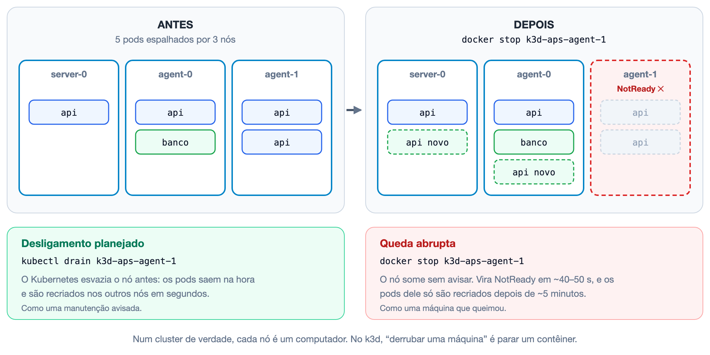

| | Desligamento planejado | Queda abrupta |
|---|---|---|
| Comando | `kubectl drain k3d-aps-agent-1` | `docker stop k3d-aps-agent-1` |
| Equivale a | Manutenção avisada: "vou desligar este servidor" | Uma máquina que queimou ou perdeu a rede |
| O que o Kubernetes sabe | Tudo: ele mesmo esvazia o nó | Nada: o kubelet simplesmente para de dar notícias |
| Quando os pods são recriados em outro nó | Na hora | O nó vira `NotReady` em ~40–50 s; os pods dele só são recriados depois de ~5 minutos |
| Volta ao normal | `kubectl uncordon` | `docker start` |

Por que a espera na queda abrupta? Porque, visto de fora, um nó que parou de responder pode estar só com a rede lenta. Se o Kubernetes recriasse os pods na primeira falha, um soluço de rede duplicaria a aplicação inteira. Ele prefere esperar: o nó tem ~40–50 segundos para dar notícia e, depois de marcado como `NotReady`, os pods dele ainda têm 5 minutos de tolerância (*toleration*) antes de serem recriados. Os dois tempos podem ser ajustados.

Duas consequências que a Etapa 5 pede para medir e explicar:

- **entre a queda e o `NotReady`**, os pods do nó morto continuam no Service, e as requisições enviadas a eles **falham**. Quantas falham depende de quantas réplicas estavam naquele nó — um bom motivo para espalhar as réplicas;
- **um pod de StatefulSet** (o banco) num nó que caiu **não é recriado sozinho**: o Kubernetes não arrisca ter duas cópias do mesmo banco escrevendo no mesmo disco. Por isso, nos experimentos de queda, derrubem um nó **que não tenha o banco** — ou registrem esse comportamento como resultado.

---

## 6. Pod: a menor unidade

### A ideia

O Kubernetes não coloca um contêiner "solto" num nó. Ele o coloca dentro de uma **embalagem** chamada **pod** (em inglês, "vagem" — a casca que envolve as ervilhas). O pod é **a menor coisa que o Kubernetes cria e gerencia**.

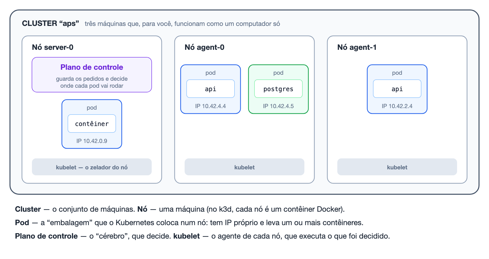

### O que o pod tem

- **um ou mais contêineres** — na APS, sempre um;
- **um endereço IP próprio**, compartilhado pelos contêineres de dentro;
- **um nome** gerado pelo Kubernetes, como `sensor-api-7bf4fb6855-jwztt`.

### Três verdades sobre o pod

O relatório precisa usar estas três com precisão:

1. **O pod é descartável.** Quando morre, ele não "volta": um pod **novo**, com outro nome e outro IP, é criado no lugar. Pensem numa lâmpada queimada: não se conserta, troca-se.
2. **O IP do pod muda a cada recriação.** Por isso ninguém deve guardar o IP de um pod para se conectar a ele — o problema que o **Service** resolve (seção 9).
3. **Pod não é contêiner.** O pod é a embalagem; o contêiner é o que vai dentro. Na APS a relação é de um para um, mas os termos não são sinônimos.

---

## 7. Namespace e rótulos: organizar e encontrar

Dois recursos simples que aparecem em todos os manifestos.

### Namespace: as pastas do cluster

Um **namespace** ("espaço de nomes") é uma **pasta** dentro do cluster. Ele agrupa os objetos de uma aplicação e evita conflito de nomes entre aplicações diferentes: dois namespaces podem ter, cada um, um Service chamado `banco`.

Na APS tudo fica no namespace `aps`. Isso traz uma vantagem prática: `kubectl delete namespace aps` apaga a aplicação inteira de uma vez. Por isso quase todo comando do laboratório termina com `-n aps` ("no namespace aps").

### Rótulos e seletores: etiquetas para encontrar

Um **rótulo** (*label*) é uma **etiqueta** do tipo `chave: valor` colada num objeto:

```yaml
metadata:
  labels:
    app: sensor-api
```

Um **seletor** (*selector*) é uma **busca** por etiqueta: "todos os pods com `app: sensor-api`".

Isso importa porque, no Kubernetes, **os objetos se encontram por rótulo, não por nome**. Os nomes dos pods mudam o tempo todo (seção 6); as etiquetas, não. O Deployment acha "os seus" pods por rótulo (seção 8), e o Service escolhe para quem mandar tráfego por rótulo (seção 9).

---

## 8. Deployment e ReplicaSet: manter cópias

### A ideia

Ninguém cria pods diretamente — eles morreriam e ninguém os recriaria. Vocês descrevem o pod **uma vez**, como um molde (o *template*), e dizem **quantas cópias** querem. Quem cuida disso é uma pequena hierarquia, como numa equipe:

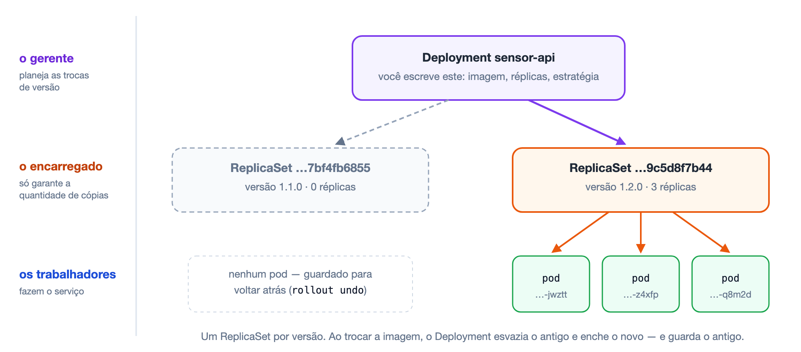

| Nível | Papel | Analogia |
|---|---|---|
| **Deployment** ("implantação") | Guarda o molde do pod e a estratégia de troca de versão. **É o que vocês escrevem.** | O gerente |
| **ReplicaSet** ("conjunto de réplicas") | Garante que exista exatamente o número de cópias pedido de **uma** versão. | O encarregado que conta cabeças |
| **Pod** | Executa o programa | Os trabalhadores |

### Por que dois níveis?

Porque é isso que permite **trocar de versão sem parar** e **voltar atrás**:

- ao trocar a imagem, o Deployment cria um **ReplicaSet novo** e vai passando as cópias do antigo para o novo, uma a uma — a **atualização contínua** (*rolling update*, seção 15);
- o ReplicaSet antigo **não é apagado**: fica lá, com zero cópias. Se a versão nova der problema, `kubectl rollout undo` o enche de novo. Voltar à versão anterior se chama **rollback**.

O sufixo estranho no nome (`7bf4fb6855`) é uma "impressão digital" do molde: mudou o molde, muda o sufixo, nasce outro ReplicaSet.

---

## 9. Service: um endereço que não muda

### A ideia

Os pods nascem e morrem, e cada um aparece com um IP diferente. Como a API encontra o banco, ou a porta de entrada encontra a API, se os endereços mudam o tempo todo?

Com o **Service** ("serviço"): um **nome fixo** que entrega cada conexão a um dos pods disponíveis naquele momento — como o **0800 de uma empresa**: o número nunca muda, e quem atende é qualquer atendente livre.

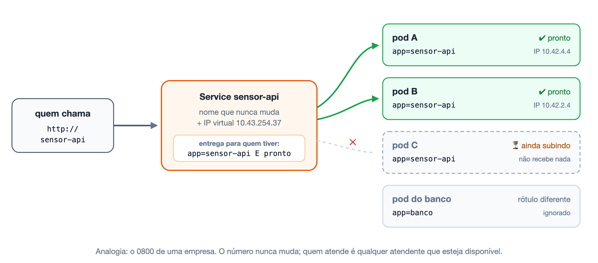

### Como ele funciona

O Service oferece duas coisas:

1. **um nome no DNS do cluster** — `sensor-api` (ou o nome completo `sensor-api.aps.svc.cluster.local`) — que nunca muda;
2. **um IP virtual** (que não pertence a nenhuma máquina) que distribui as conexões entre os pods escolhidos.

E escolhe os pods por **seletor** (seção 7):

```yaml
spec:
  selector:
    app: sensor-api       # todo pod com esta etiqueta...
  ports:
    - port: 80            # ...recebe o que chegar na porta 80 do Service
      targetPort: 8080    # ...na porta 8080 do contêiner
```

Consequências práticas, todas visíveis na figura:

- **pod novo com a etiqueta entra sozinho** no rodízio;
- **pod que não está pronto sai sozinho** (seção 13) — como o pod C;
- pod com outra etiqueta (o banco) é ignorado.

É exatamente o papel que `Host=banco` cumpria no Compose: um **nome** em vez de um endereço.

### Os tipos de Service

| Tipo | Quem consegue acessar | Uso na APS |
|---|---|---|
| `ClusterIP` (padrão) | Só quem está dentro do cluster | Todos os serviços e o banco |
| `NodePort` | Uma porta alta (30000–32767) em cada nó | Não é necessário — o Ingress cumpre o papel |
| `LoadBalancer` | Um IP externo, fornecido pela nuvem | Usado pelo próprio controlador de Ingress |
| *Headless* (`clusterIP: None`, "sem cabeça") | Um nome fixo para cada pod, sem distribuir | O banco (seção 12) |

### Um detalhe que vai importar: camada 4

O Service distribui na **camada 4**: ele enxerga **conexões TCP** — endereço e porta —, mas não lê o conteúdo HTTP. Não sabe qual é a URL, o verbo ou os cabeçalhos. A próxima seção mostra por que isso faz diferença.

---

## 10. Ingress: a porta de entrada

### A ideia

O Service `ClusterIP` só é alcançável **de dentro** do cluster. Para o cliente da APS — que está **fora** — chegar aos serviços, existe o **Ingress** ("entrada"): uma porta de entrada única que **lê a URL** de cada requisição e decide para qual Service mandá-la. É a **recepção de um prédio**: você diz o assunto, a recepcionista indica o andar.

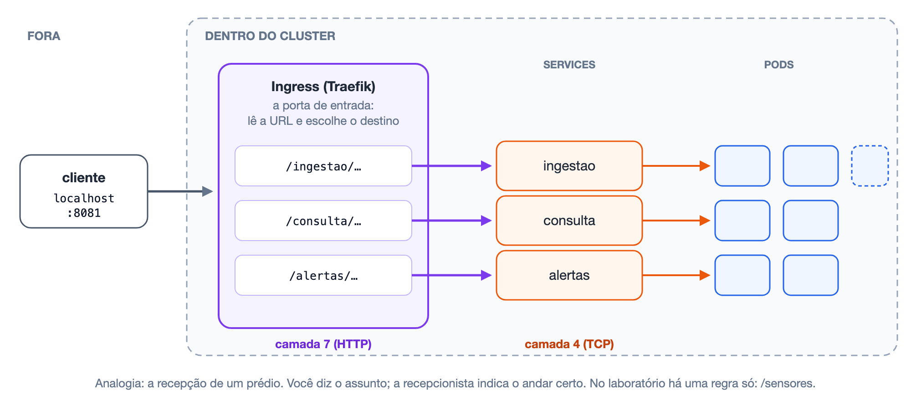

Na arquitetura da APS, o Ingress é o **API Gateway**: o ponto único por onde o cliente fala com todos os serviços.

### Regra e executor

O objeto `Ingress` é só a **regra** ("o que começar com `/sensores` vai para o Service `sensor-api`"). Quem a executa é um **controlador de Ingress** — um proxy reverso (seção 3) rodando dentro do cluster. O k3d já traz o **Traefik**; outros clusters usam NGINX, HAProxy etc.

> O controlador **ingress-nginx**, mantido pela comunidade Kubernetes, foi aposentado em março de 2026 e não recebe mais correções. Em clusters novos, prefiram Traefik ou outro controlador mantido. O sucessor do Ingress no próprio Kubernetes é a **Gateway API**; para a APS, o Ingress continua sendo o recurso exigido e suficiente.

### Camada 4 × camada 7

O documento da APS pede que vocês discutam essa diferença. Ela fica clara num caso concreto: navegadores e clientes HTTP costumam **reaproveitar a mesma conexão TCP** para várias requisições — o recurso se chama ***keep-alive*** ("manter viva").

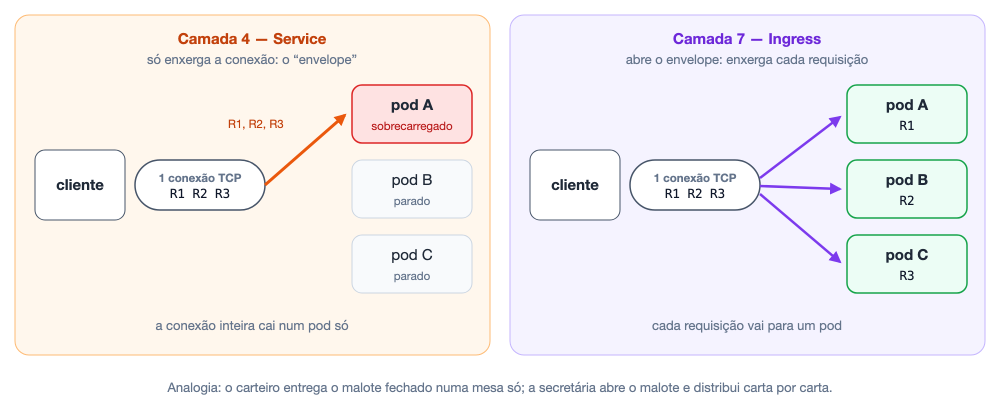

| | Service (camada 4) | Ingress (camada 7) |
|---|---|---|
| Enxerga | IP e porta | URL, cabeçalhos, verbo, cookies |
| Decide por | Rótulo dos pods | Caminho (`/consulta`) ou domínio (`api.exemplo.com`) |
| Distribui | Conexões TCP | Requisições HTTP, uma a uma |
| Pode fazer HTTPS, limite de requisições, autenticação | Não | Sim |
| Quantos existem | Um por serviço | Um para a aplicação inteira |

---

## 11. ConfigMap e Secret: configuração fora da imagem

### A ideia

A **imagem** é o programa; a **configuração** é o que muda de um lugar para outro — endereço do banco, senha, prefixo da URL. Se a configuração estiver dentro da imagem, é preciso uma imagem diferente para cada ambiente. Separando as duas, **a mesma imagem roda no notebook, no laboratório e na nuvem**.

Na Etapa 2 a configuração vinha do arquivo `.env`. No Kubernetes ela vira dois objetos do cluster:

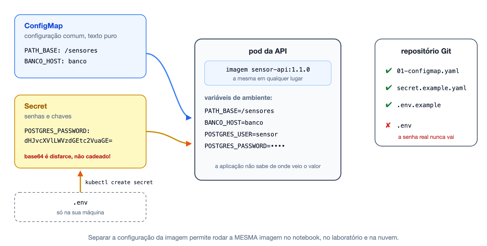

| | ConfigMap ("mapa de configuração") | Secret ("segredo") |
|---|---|---|
| Para quê | Configuração comum (prefixo da URL, nome do banco, nível de log) | Credenciais (senha do banco, chave de API, token) |
| Como fica guardado | Texto puro | Codificado em **Base64** — que **não** é criptografia |
| Vai para o Git? | Sim | **Não.** Versiona-se só um modelo; o real é criado a partir do `.env` |

O pod recebe os dois como **variáveis de ambiente**. A aplicação não sabe — nem precisa saber — se o valor veio do `.env`, do Compose ou de um Secret.

> **Base64 não protege nada.** É só outra forma de escrever o mesmo texto, usando apenas letras e números: `echo dHJvcXVlLWVzdGEtc2VuaGE= | base64 -d` devolve `troque-esta-senha`. O Secret é separado do ConfigMap para poder ter **controle de acesso** próprio e, em produção, criptografia no armazenamento do cluster. Por isso o requisito "sem credenciais no código-fonte" continua valendo: o arquivo com a senha real **não** entra no repositório.

---

## 12. StatefulSet e volume: o serviço que guarda dados

### A ideia

Lembrem da seção 3: a API é **sem estado** — qualquer cópia atende qualquer requisição, e perder uma não perde nada. O banco é **com estado** — **os dados são o serviço**; perder o disco é perder tudo.

Há uma analogia clássica em infraestrutura: serviços sem estado são **gado** (uma cabeça vale qualquer outra); serviços com estado são **animais de estimação** (têm nome, e não se trocam).

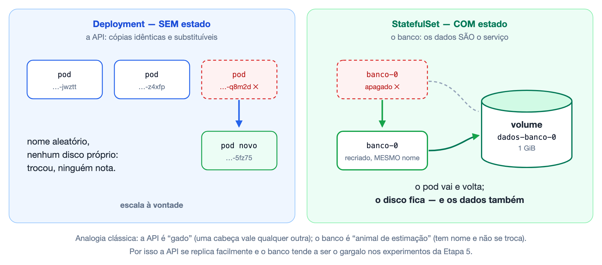

Para o primeiro tipo, usa-se o Deployment (seção 8). Para o segundo, o **StatefulSet** ("conjunto com estado"):

| | Deployment | StatefulSet |
|---|---|---|
| Nome dos pods | Aleatório (`sensor-api-7bf4fb6855-jwztt`) | Fixo e numerado (`banco-0`, `banco-1`) |
| Disco | Nenhum próprio | **Um por pod**, reconectado quando o pod é recriado |
| Escalar | `kubectl scale` e pronto | Exige que o próprio banco saiba replicar (réplica de leitura, cluster de banco) |
| Na APS | Os três serviços | O banco |

### Como se pede um disco

- **PersistentVolumeClaim** (PVC, "pedido de volume persistente"): o **pedido** — "preciso de 1 GiB que sobreviva ao pod".
- **PersistentVolume** (PV, "volume persistente"): o **disco de fato** que atende o pedido. No k3d, uma pasta no nó, criada automaticamente pelo provisionador `local-path`.

É o equivalente do volume nomeado do Compose. O documento da APS pede exatamente esta discussão: **serviços sem estado se replicam à vontade; serviços com estado, não** — e é por isso que o banco tende a ser o **gargalo** dos experimentos de escalabilidade da Etapa 5.

---

## 13. Probes: liveness e readiness

### A ideia

Uma **probe** ("sonda") é uma verificação periódica que o kubelet faz em cada contêiner — normalmente, chamar uma rota de *health check*. Existem duas perguntas diferentes, e cada resposta negativa tem uma consequência diferente:

- **Liveness ("vivacidade") — "você está vivo?"** Se o programa travou, não adianta esperar: o kubelet **reinicia o contêiner**.
- **Readiness ("prontidão") — "pode atender agora?"** O programa está vivo, mas não consegue trabalhar (por exemplo, o banco caiu). Reiniciar não resolveria nada; o pod só **para de receber requisições** até se recuperar.

Pensem no **caixa de supermercado com a placa "caixa fechado"**: a funcionária está ali (viva), mas não recebe clientes (não está pronta). Ninguém a manda para casa por isso.

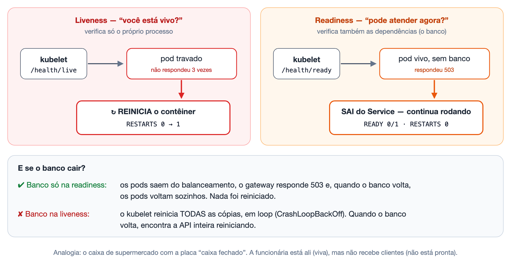

### Os detalhes

Na Etapa 2 os endpoints `/health/live` e `/health/ready` já existiam, mas ninguém agia sobre eles. Agora eles têm consequência:

| Probe | Pergunta | Se falhar |
|---|---|---|
| `livenessProbe` | O processo está vivo? | O kubelet **reinicia o contêiner** (a coluna `RESTARTS` aumenta) |
| `readinessProbe` | Está apto a receber tráfego agora? | O pod **sai do Service** — não recebe requisições —, mas continua rodando |
| `startupProbe` (opcional) | Já terminou de iniciar? | Adia as outras duas; útil para aplicação que demora a subir |

A regra de ouro, que vem da Aula Prática 2: **liveness não verifica dependências; readiness verifica**. A parte de baixo da figura mostra por quê: com o banco na liveness, uma queda do banco faria o kubelet reiniciar todas as cópias da API sem parar. Esse estado tem nome — **`CrashLoopBackOff`**, "laço de quedas com espera crescente" — e é um dos erros mais comuns em Kubernetes.

---

## 14. Requests, limits e HPA

### A ideia: quanto cada pod pode usar

Vários pods dividem as mesmas máquinas. Para ninguém passar fome nem engolir o vizinho, cada contêiner declara duas medidas:

- **requests ("pedido") — a reserva.** "Preciso de pelo menos isto." O scheduler só coloca o pod num nó que tenha essa sobra. Como reservar uma mesa no restaurante.
- **limits ("limites") — o teto.** "Nunca use mais que isto." Como a lotação máxima do salão.

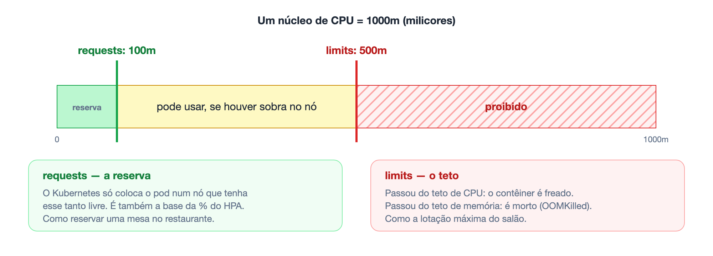

```yaml
resources:
  requests: { cpu: 100m, memory: 96Mi }    # reserva
  limits:   { cpu: 500m, memory: 256Mi }   # teto
```

**As unidades:**

- a CPU é medida em **milicores** (milésimos de núcleo): `1000m` = um núcleo inteiro, então `100m` = 10% de um núcleo;
- a memória, em `Mi` (**mebibytes**, 1 Mi = 1.048.576 bytes, praticamente um megabyte).

**O que acontece quando se passa do teto:**

| Recurso | Consequência | Nome |
|---|---|---|
| CPU | O contêiner é **freado**: continua rodando, mais devagar | *throttling* ("estrangulamento") |
| Memória | O contêiner é **morto** pelo sistema e reiniciado | `OOMKilled` (*Out Of Memory*, "sem memória") |

### A ideia: escalar sozinho (HPA)

Num supermercado, quando a fila cresce, o gerente abre mais caixas; quando esvazia, fecha. O **HorizontalPodAutoscaler** (HPA, "autoescalonador horizontal de pods") faz isso com os pods: observa o uso de CPU e **muda o número de réplicas** do Deployment. "Horizontal" porque aumenta a **quantidade** de pods, não o tamanho de cada um (seção 3).

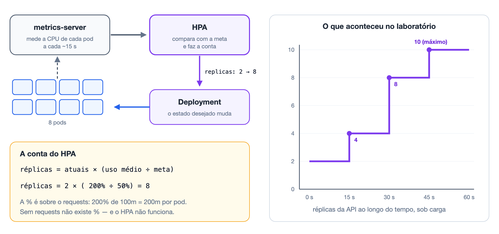

Quem mede a CPU é o **metrics-server** ("servidor de métricas"), um componente que o k3s já traz. É ele também que faz o comando `kubectl top pod` responder.

A conta do HPA é simples:

```
réplicas desejadas = réplicas atuais × (uso médio de CPU ÷ meta)
```

O detalhe que costuma passar despercebido: **a porcentagem é calculada sobre o `requests`**. Com `requests: 100m` e meta de 50%, cada pod "deveria" usar 50m; se a média chegar a 200m (200%), o HPA quer **4 vezes** mais réplicas. **Sem `requests`, a porcentagem não existe e o HPA não funciona** — é por isso que o documento da APS torna os limites obrigatórios.

Para não ficar abrindo e fechando pods sem parar, o HPA **sobe rápido e desce devagar**: por padrão, espera 5 minutos de calma antes de reduzir.

---

## 15. Rolling update: trocar de versão sem parar

### A ideia

Para trocar todos os caixas de turno sem fechar o supermercado, troca-se **um por vez**: o novo chega, assume o caixa, e só então o antigo vai embora. O Kubernetes faz o mesmo com as versões da aplicação — a **atualização contínua** (*rolling update*):

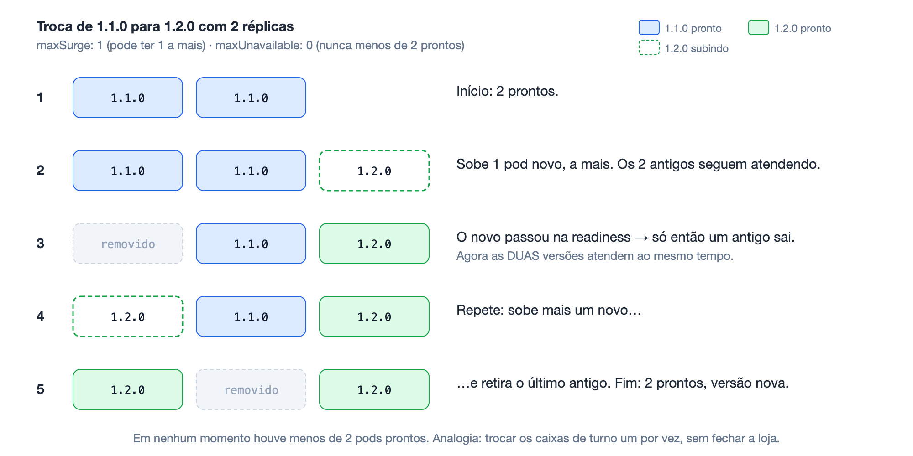

O Deployment declara as regras da troca:

```yaml
strategy:
  type: RollingUpdate
  rollingUpdate:
    maxSurge: 1           # pode ter 1 pod a MAIS que o pedido durante a troca
    maxUnavailable: 0     # nunca pode ter MENOS pods prontos que o pedido
```

- **`maxSurge`** ("excesso máximo"): quantos pods **extras** podem existir durante a troca;
- **`maxUnavailable`** ("indisponíveis no máximo"): quantos pods podem **faltar**.

Ao trocar a imagem, o Deployment sobe um pod da versão nova, **espera ele passar na readiness**, retira um da versão antiga, e repete. Duas coisas a observar:

- a **readiness** é o que garante que ninguém seja mandado para um pod que ainda não está pronto — sem ela, a troca seria às cegas;
- durante a transição **as duas versões atendem ao mesmo tempo** — o que o documento da APS pede para evidenciar na Etapa 5.

Se a versão nova der problema, `kubectl rollout undo` faz o caminho inverso: o **rollback** (seção 8).

---

## 16. Resumo

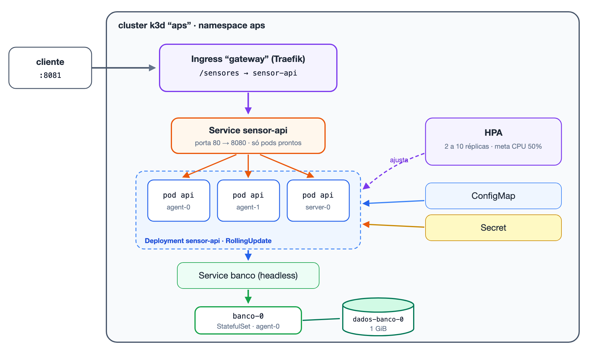

| Termo | Em uma frase | Analogia |
|---|---|---|
| **Orquestrador** | Sistema que administra muitos contêineres em várias máquinas | O maestro |
| **Estado desejado** | Vocês descrevem o resultado; o cluster persegue isso sem parar | Termostato |
| **Cluster / nó** | Várias máquinas administradas como uma só | — |
| **Plano de controle** | A parte do cluster que guarda os pedidos e decide | O cérebro |
| **kubelet** | O agente de cada nó, que liga e vigia os contêineres | O zelador |
| **Pod** | A embalagem descartável onde o contêiner roda | Lâmpada: queimou, troca |
| **Namespace** | Pasta que agrupa os objetos de uma aplicação | Pasta |
| **Rótulo / seletor** | Etiqueta e busca por etiqueta | Etiqueta |
| **Deployment** | Molde do pod + número de cópias + estratégia de troca | O gerente |
| **ReplicaSet** | Mantém a contagem de cópias de uma versão | O encarregado |
| **Service** | Nome fixo que entrega para os pods prontos (camada 4) | O 0800 |
| **Ingress** | Porta de entrada que lê a URL e escolhe o serviço (camada 7) | A recepção do prédio |
| **ConfigMap / Secret** | Configuração e senhas fora da imagem | — |
| **StatefulSet + PVC** | Pod com nome fixo e disco próprio, para quem guarda dados | Animal de estimação |
| **Liveness** | "Está vivo?" — se não, reinicia | Checar o pulso |
| **Readiness** | "Pode atender?" — se não, sai do rodízio | Placa "caixa fechado" |
| **requests / limits** | A reserva e o teto de CPU e memória | Mesa reservada / lotação |
| **HPA** | Ajusta o número de pods pela CPU | Abrir mais caixas |
| **Rolling update** | Troca de versão um pod por vez | Troca de turno |

Na **Aula Prática 3** vocês vão montar exatamente a arquitetura da figura acima, passo a passo, e provocar cada uma das situações descritas aqui.

---

## 17. Glossário

Todos os termos da aula, em ordem alfabética. Entre parênteses, a seção onde o termo é explicado.

| Termo | Significado |
|---|---|
| **API server** | Componente do plano de controle que recebe todos os pedidos e é a única porta de acesso ao etcd. (5) |
| **Base64** | Forma de reescrever dados usando só letras, números e alguns símbolos. Não é criptografia: qualquer um desfaz. (11) |
| **Cluster** | Conjunto de máquinas (nós) administradas como uma só. (5) |
| **ClusterIP** | Tipo padrão de Service, acessível apenas de dentro do cluster. (9) |
| **ConfigMap** | Objeto que guarda configuração não sensível, entregue ao pod como variáveis de ambiente. (11) |
| **containerd** | Runtime de contêiner usado pelo k3s (e, por baixo, pelo Docker). (5) |
| **Controlador** | Programa do plano de controle que executa um laço de controle para um tipo de objeto. (5) |
| **Controlador de Ingress** | Proxy reverso que executa as regras dos objetos Ingress (Traefik, NGINX…). (10) |
| **CrashLoopBackOff** | Estado de um pod cujo contêiner cai repetidamente; o kubelet espera cada vez mais entre as tentativas. (13) |
| **Declarativo** | Estilo em que se descreve o resultado desejado, e não os passos para chegar a ele. (4) |
| **Deployment** | Objeto que mantém N cópias de um pod sem estado e gerencia a troca de versões. (8) |
| **Distribuição** | Versão empacotada do Kubernetes (k3s, EKS, AKS, GKE, OpenShift…). (2) |
| **Drain** | Esvaziar um nó de forma planejada (`kubectl drain`): os pods saem e são recriados em outros nós na hora. (5) |
| **Estado atual** | O que de fato está rodando no cluster neste momento. (4) |
| **Estado desejado** | O que foi pedido nos manifestos e está gravado no etcd. (4) |
| **etcd** | Banco de dados do plano de controle onde fica o estado desejado. (5) |
| **Gateway API** | Recurso mais recente do Kubernetes, sucessor do Ingress. (10) |
| **Headless Service** | Service sem IP virtual (`clusterIP: None`), que dá um nome DNS fixo a cada pod. Usado com StatefulSet. (9, 12) |
| **HPA** (*HorizontalPodAutoscaler*) | Objeto que ajusta o número de réplicas de um Deployment conforme o uso de CPU. (14) |
| **Imperativo** | Estilo em que se dão ordens passo a passo. (4) |
| **Ingress** | Objeto com regras de entrada HTTP: qual caminho ou domínio vai para qual Service. (10) |
| **k3d** | Ferramenta que cria clusters k3s dentro do Docker, com cada nó sendo um contêiner. (5) |
| **k3s** | Distribuição leve do Kubernetes, num único programa, já com Traefik, metrics-server e `local-path`; roda em modo servidor ou agente. (5) |
| **K8s** | Abreviação de Kubernetes. (2) |
| **Keep-alive** | Reaproveitamento de uma mesma conexão TCP para várias requisições HTTP. (10) |
| **kube-proxy** | Componente de cada nó que configura a rede para os Services funcionarem. (5) |
| **kubectl** | Programa de linha de comando para falar com o cluster. (4) |
| **kubelet** | Agente de cada nó que liga os contêineres e executa as probes. (5) |
| **Laço de controle** | Ciclo contínuo de observar, comparar com o desejado e agir. (4) |
| **Limits** | Teto de CPU e memória de um contêiner. (14) |
| **Liveness probe** | Verificação "está vivo?"; se falhar, o contêiner é reiniciado. (13) |
| **LoadBalancer** | Tipo de Service que recebe um IP externo, normalmente da nuvem. (9) |
| **Manifesto** | Arquivo YAML que descreve um ou mais objetos do Kubernetes. (4) |
| **maxSurge / maxUnavailable** | Quantos pods podem sobrar / faltar durante um rolling update. (15) |
| **Mebibyte** (`Mi`) | Unidade de memória: 1.048.576 bytes. (14) |
| **metrics-server** | Componente que mede CPU e memória dos pods; alimenta o HPA e o `kubectl top`. (14) |
| **Milicore** (`m`) | Milésimo de um núcleo de CPU: `1000m` = 1 núcleo. (14) |
| **Namespace** | Pasta lógica que agrupa objetos dentro do cluster. (7) |
| **Nó** (*node*) | Uma máquina do cluster. (5) |
| **NodePort** | Tipo de Service exposto numa porta alta de cada nó. (9) |
| **NotReady** | Estado de um nó que parou de dar notícias ao plano de controle (em ~40–50 s). (5) |
| **Objeto** / **recurso** | Qualquer coisa que se pede ao Kubernetes (Deployment, Service, Secret…). (4) |
| **OOMKilled** | Contêiner morto por passar do limite de memória. (14) |
| **Orquestrador** | Sistema que decide quantos contêineres existem, onde rodam e como se recuperam. (2) |
| **PersistentVolume** (PV) | O disco que atende um pedido de volume. (12) |
| **PersistentVolumeClaim** (PVC) | O pedido de um disco que sobrevive ao pod. (12) |
| **Plano de controle** | Conjunto de componentes que guarda o estado e decide (API server, etcd, scheduler, controladores). (5) |
| **Pod** | A menor unidade do Kubernetes: um ou mais contêineres com IP próprio. (6) |
| **Probe** | Verificação periódica feita pelo kubelet num contêiner. (13) |
| **Readiness probe** | Verificação "pode atender agora?"; se falhar, o pod sai do Service, sem reiniciar. (13) |
| **ReplicaSet** | Objeto que mantém N cópias de uma versão de pod; criado pelo Deployment. (8) |
| **Requests** | Reserva mínima de CPU e memória; usada pelo scheduler e como base da % do HPA. (14) |
| **Rollback** | Voltar à versão anterior (`kubectl rollout undo`). (8, 15) |
| **Rolling update** | Troca de versão um pod por vez, sem interromper o serviço. (15) |
| **Rótulo** (*label*) | Etiqueta `chave: valor` colada num objeto. (7) |
| **Runtime de contêiner** | Programa que cria os contêineres a partir das imagens. (5) |
| **Scheduler** | Componente que escolhe o nó de cada pod novo. (5) |
| **Secret** | Objeto que guarda credenciais, separado da configuração comum. (11) |
| **Seletor** (*selector*) | Busca de objetos por rótulo. (7) |
| **Service** | Nome e IP estáveis que distribuem conexões entre os pods prontos de um seletor. (9) |
| **startupProbe** | Verificação opcional que adia liveness e readiness até a aplicação terminar de iniciar. (13) |
| **StatefulSet** | Objeto para serviços com estado: pods com nome fixo e disco próprio. (12) |
| **Template** | O molde do pod dentro de um Deployment ou StatefulSet. (8) |
| **Throttling** | Freio aplicado ao contêiner que tenta passar do limite de CPU. (14) |
| **Toleration** | Tempo que um pod "tolera" uma condição ruim do nó antes de ser recriado em outro; 5 minutos para nó `NotReady`. (5) |
| **Traefik** | Controlador de Ingress que vem com o k3s. (10) |

---

## Referências

- **Documento da APS 2026** — *Infraestrutura Distribuída*, itens II.2, II.3, II.4 e II.6
- THE KUBERNETES AUTHORS. *Kubernetes Documentation* — [Visão geral](https://kubernetes.io/docs/concepts/overview/), [Componentes](https://kubernetes.io/docs/concepts/overview/components/), [Pods](https://kubernetes.io/docs/concepts/workloads/pods/), [Deployments](https://kubernetes.io/docs/concepts/workloads/controllers/deployment/), [Service](https://kubernetes.io/docs/concepts/services-networking/service/), [Ingress](https://kubernetes.io/docs/concepts/services-networking/ingress/), [StatefulSets](https://kubernetes.io/docs/concepts/workloads/controllers/statefulset/), [Probes](https://kubernetes.io/docs/tasks/configure-pod-container/configure-liveness-readiness-startup-probes/), [HorizontalPodAutoscaler](https://kubernetes.io/docs/tasks/run-application/horizontal-pod-autoscale/), [Glossário oficial](https://kubernetes.io/docs/reference/glossary/)
- VERMA, Abhishek et al. *Large-scale cluster management at Google with Borg*. EuroSys, 2015.
- BURNS, Brendan; BEDA, Joe; HIGHTOWER, Kelsey. *Kubernetes: Up and Running*. 3. ed. O'Reilly, 2022.
- NEWMAN, Sam. *Construindo Microsserviços*. 2. ed. Novatec, 2022.
