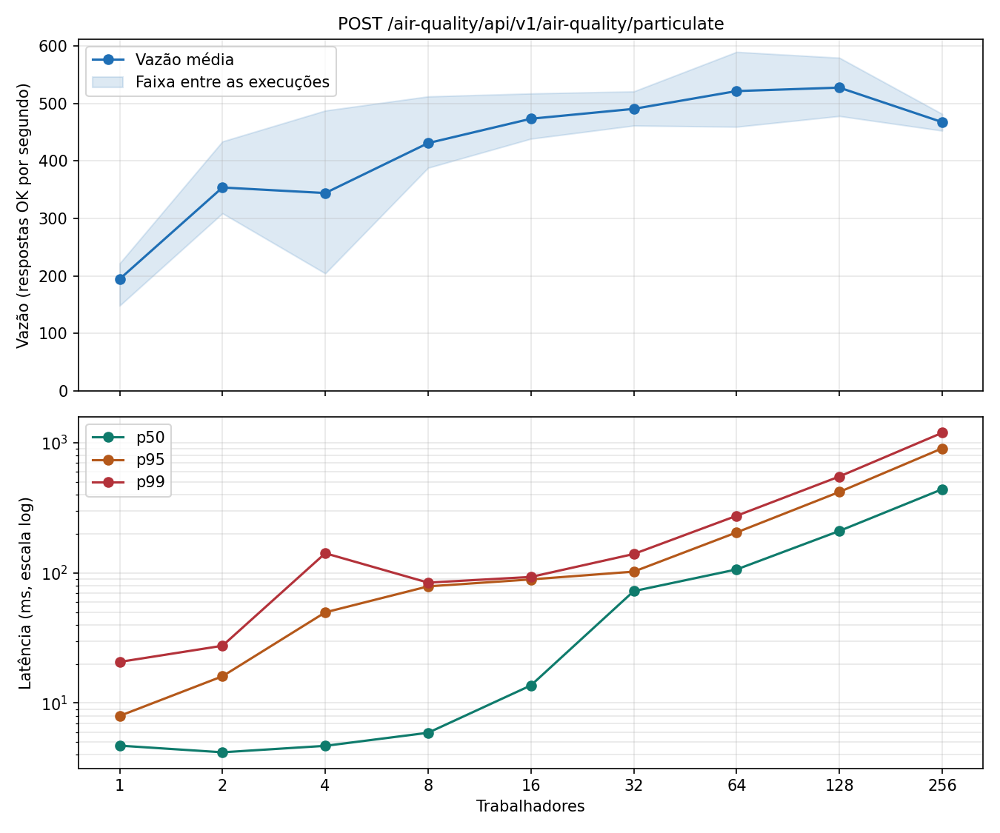
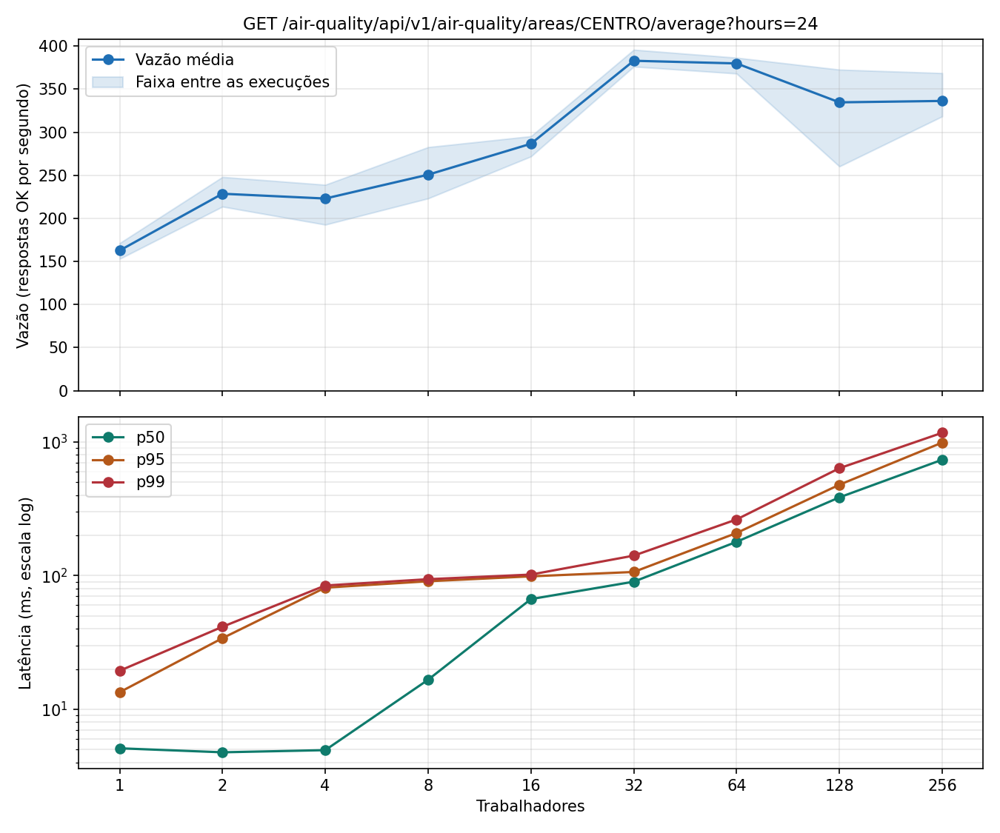
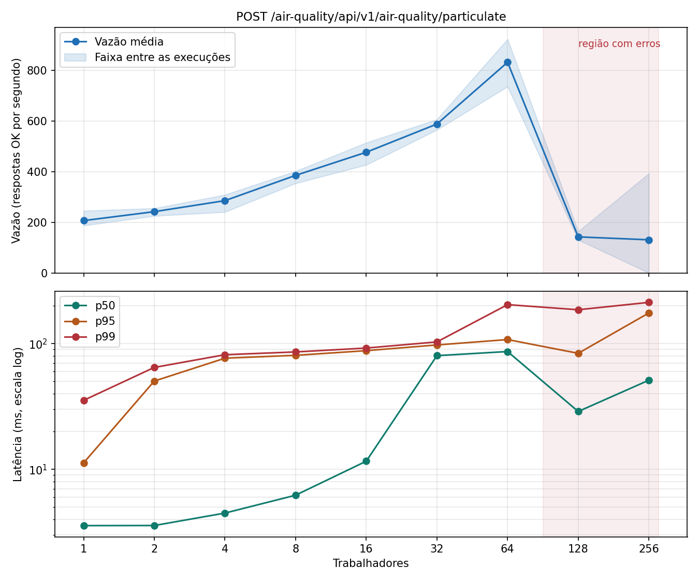

# Etapa 4: gerador de carga e linha de base

## Medição atual (12/11/2026, sem Redis e RabbitMQ)

Refeita depois de tirar o cache e a fila: o POST agora avalia o alerta na própria requisição, e a consulta agregada é calculada no banco a cada chamada. Mesmo procedimento: 1 réplica, sem HPA, 3 execuções por rota, degraus de 30 s com 5 s de aquecimento. Arquivos em `resultados/base/`; tabelas completas em `resultados/base/tabela-post.md` e `tabela-get.md`.

| Rota | Ponto de saturação | Depois disso | O que saturou |
|---|---|---|---|
| `POST .../particulate` | ~490 req/s, p95 de 102 ms, em 32 trabalhadores | Vazão parada em ~520 req/s; p95 de 204 ms (64), 417 ms (128) e 902 ms (256); **0 erros** | CPU do pod (500m desde 2 trabalhadores); banco ~360m |
| `GET .../areas/CENTRO/average` | ~383 req/s, p95 de 106 ms, em 32 trabalhadores | Vazão ~335 a 380 req/s; p95 de 208 ms a 986 ms; **0 erros** | CPU do pod; banco subiu junto até ~660m |

A Lei de Little bateu em todos os degraus (64,1 para 64 trabalhadores no POST) e o gerador usou no máximo 51% de um núcleo. Diferente da medição anterior, o sistema não recusou carga com `503`: a latência subiu e nada falhou.

---

## Medição anterior (31/10/2026, com Redis e RabbitMQ)

O texto abaixo descreve a primeira medição, feita quando o sistema ainda tinha cache e fila. Os arquivos estão em `resultados/antes-da-remocao/base/`.

Medições de 31/10/2026. Os arquivos brutos estão em `resultados/antes-da-remocao/base/`, e o procedimento completo em `carga/linha_base.sh`.

### Ambiente de medição

| Item | Valor |
|---|---|
| Máquina | Intel Core i5-13450HX, 10 núcleos (16 threads), 15,7 GB de RAM |
| Cluster | k3d com 3 nós, todos na mesma máquina |
| Gerador | `carga/loadgen.py`, na mesma máquina do cluster |
| Configuração | 1 réplica de cada serviço, HPA removido |
| Procedimento | 9 degraus (1 a 256 trabalhadores), 30 s por degrau, 5 s de aquecimento descartados, 3 execuções por rota |

A ficha pede degraus até 64 "ou até saturar". O POST ainda aceitava mais carga em 64, então acrescentamos 128 e 256.

### Por que estas rotas

**Ingestão: `POST /air-quality/api/v1/air-quality/particulate`.** É a rota do serviço que o HPA vai escalar. Cada requisição consome CPU do pod, faz uma escrita no banco e publica uma mensagem na fila, e o consumidor de alertas roda no mesmo pod. Exercita todo o caminho de escrita.

**Consulta: `GET /air-quality/api/v1/air-quality/areas/CENTRO/average?hours=24`.** É a consulta agregada mais cara da API, mas o resultado fica 10 s no Redis, então quase toda requisição consome só CPU do pod e o cache. O custo fica estável porque a carga do POST grava na área CARGA, e não na CENTRO.

### Resultados (média de 3 execuções)

### POST

| Trab. | Requisições | Vazão (req/s) | p50 (ms) | p95 (ms) | p99 (ms) | Erros (%) | CPU do pod (m) | CPU banco (m) | Fila ao fim |
|---:|---:|---:|---:|---:|---:|---:|---:|---:|---:|
| 1 | 5.169 | 206,7 | 3,6 | 11,2 | 35,4 | 0 | 368 | 129 | 4 |
| 2 | 6.050 | 242,0 | 3,6 | 50,4 | 64,7 | 0 | 500 | 217 | 12 |
| 4 | 7.137 | 285,5 | 4,5 | 76,7 | 81,7 | 0 | 494 | 237 | 1.604 |
| 8 | 9.631 | 385,2 | 6,2 | 80,8 | 86,0 | 0 | 499 | 275 | 7.933 |
| 16 | 11.913 | 476,5 | 11,6 | 88,0 | 92,3 | 0 | 497 | 298 | 18.580 |
| 32 | 14.696 | 587,9 | 80,3 | 97,8 | 103,4 | 0 | 496 | 335 | 33.896 |
| 64 | 20.794 | 831,7 | 86,6 | 107,9 | 204,7 | 0 | 495 | 389 | 56.112 |
| 128 | 89.556 | 142,5 | 28,9 | 83,9 | 186,5 | 96,01 | 498 | 402 | 58.246 |
| 256 | 103.294 | 131,0 | 51,2 | 175,8 | 213,4 | 95,93 | 498 | 275 | 48.985 |

### GET

| Trab. | Requisições | Vazão (req/s) | p50 (ms) | p95 (ms) | p99 (ms) | Erros (%) | CPU do pod (m) | CPU banco (m) |
|---:|---:|---:|---:|---:|---:|---:|---:|---:|
| 1 | 17.289 | 691,6 | 1,4 | 2,0 | 2,5 | 0 | 326 | 8 |
| 2 | 17.792 | 711,7 | 1,5 | 2,6 | 20,9 | 0 | 449 | 7 |
| 4 | 18.603 | 744,1 | 1,8 | 8,9 | 58,2 | 0 | 380 | 9 |
| 8 | 21.343 | 853,7 | 2,5 | 62,2 | 76,6 | 0 | 401 | 9 |
| 16 | 22.157 | 886,3 | 4,9 | 74,1 | 81,6 | 0 | 410 | 11 |
| 32 | 26.982 | 1.079,3 | 10,0 | 80,2 | 90,2 | 0 | 423 | 13 |
| 64 | 32.389 | 1.295,5 | 23,1 | 94,2 | 303,8 | 0 | 436 | 20 |
| 128 | 42.816 | 1.712,6 | 79,0 | 116,8 | 347,3 | 0 | 451 | 28 |
| 256 | 99.752 | 785,4 | 63,1 | 130,5 | 367,2 | 66,67 | 469 | 53 |

### Análise

**Frase-régua.** Com uma réplica (limite de 500m de CPU), a ingestão chega a 832 req/s com p95 de 108 ms em 64 trabalhadores, sem erros. Em 128 trabalhadores o pod sai do balanceamento e 96% das requisições recebem `503`. O recurso que satura é a CPU do pod, parada em 500m. A vazão de 832 req/s, porém, não é sustentável: a fila de alertas cresce desde 4 trabalhadores e termina com 56 mil mensagens. A maior carga em que a fila acompanhou foi a de 2 trabalhadores, cerca de 240 req/s.

**Onde está o joelho.** A curva não seguiu o formato clássico. A CPU do pod já está no limite com 2 trabalhadores, mas a vazão continua subindo até 64. Depois não há um patamar, e sim um colapso entre 64 e 128. O ponto de saturação registrado é 64 trabalhadores, o último nível sem erros nas 3 execuções.

**Por que a vazão sobe com a CPU no limite.** A API e o consumidor de alertas dividem os mesmos 500m. A fila crescendo mostra que, com mais trabalhadores, o consumidor fica para trás. Isso indica que as requisições HTTP estão tomando CPU do consumidor, o que libera vazão de POST às custas dos alertas. Essa é a nossa interpretação: os dados mostram o efeito, mas não medimos a CPU separada por atividade.

**O que saturou.** CPU do serviço (limit). O pod ficou entre 494m e 500m do degrau 2 em diante. O banco chegou a 402m com limite de 1 núcleo, e o Redis ficou folgado.

**O gerador foi o limite?** Até 64 trabalhadores, não: usou no máximo 52% de um núcleo no POST e 62% no GET, e a Lei de Little bateu em todos os degraus sem erro. Nos degraus com `503` ele passou de 100%, porque essas respostas são muito rápidas. Isso não afeta o ponto de saturação.

**A máquina hospedeira foi o limite?** Não medimos a CPU total da máquina durante os testes, então não dá para descartar.

### Cuidados ao ler estes números

- **Latência nos degraus com erro.** Em 128 e 256, p50 e p95 parecem melhores porque incluem os `503`, que são quase instantâneos. Nesses degraus, olhe a taxa de erro primeiro.
- **Médias de 256 trabalhadores.** O resultado variou muito. No GET, duas execuções deram 100% de `503` e uma deu 2.356 req/s sem erros. A média de 66,67% não descreve nenhuma delas. Por isso, a vazão máxima do GET registrada é a de 128 trabalhadores (1.713 req/s, p95 de 117 ms).
- **CPU do RabbitMQ.** Ficou em torno de 330m mesmo no GET, com a fila vazia. Parte disso vem da nossa própria amostragem, que roda `rabbitmqctl` a cada 5 s. Por isso não usamos esse número para concluir nada sobre a fila.
- **CPU do pod.** É o maior valor de `kubectl top` em cada degrau, na média das execuções. O metrics-server atualiza a cada 15 s ou mais.
- **Saltos de latência.** O p95 sobe para 50 a 80 ms já com poucos trabalhadores, enquanto o p50 continua baixo. Suspeitamos do estrangulamento de CPU do limite de 500m (CPU throttling), mas não confirmamos.
- **Execuções descartadas.** `post-rep1` e `post-rep2` são ensaios: a primeira não tem dados de CPU, e a segunda tem o `top` fora do horário do teste. A `post-rep2` mostrou 41% de `503` em 128 trabalhadores, então o ponto de ruptura variou.

### Verificação com 2 réplicas

`python carga/loadgen.py .../particulate --payload ar -c 8 -d 20`: 296 req/s, p95 de 90 ms, 0% de erro, 2.218 requisições em cada pod.

Foi medida com o cluster recém-restaurado. Em relação à linha de base com 8 trabalhadores, 2 réplicas não aumentaram a vazão: isso fica para a Etapa 5 investigar.
