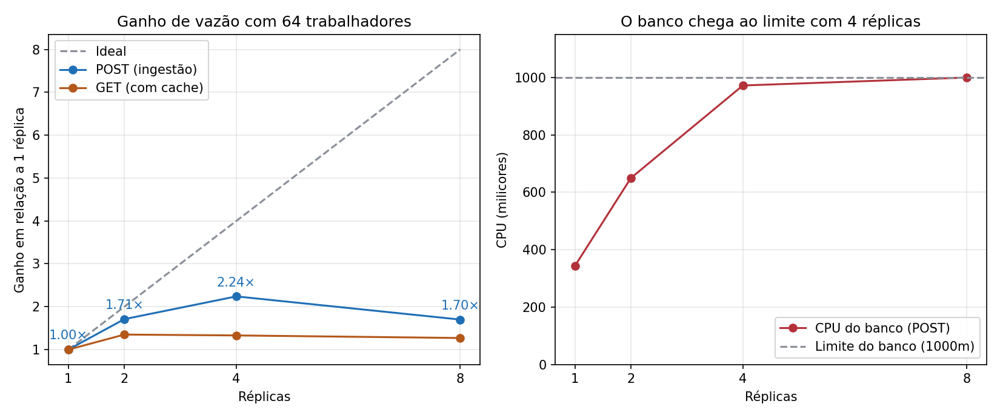
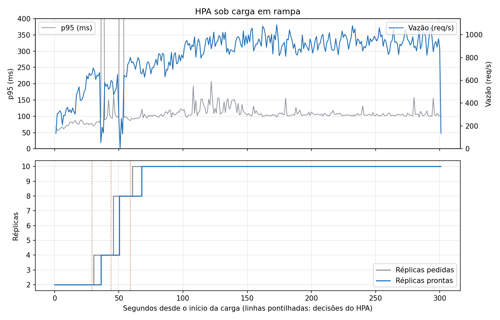
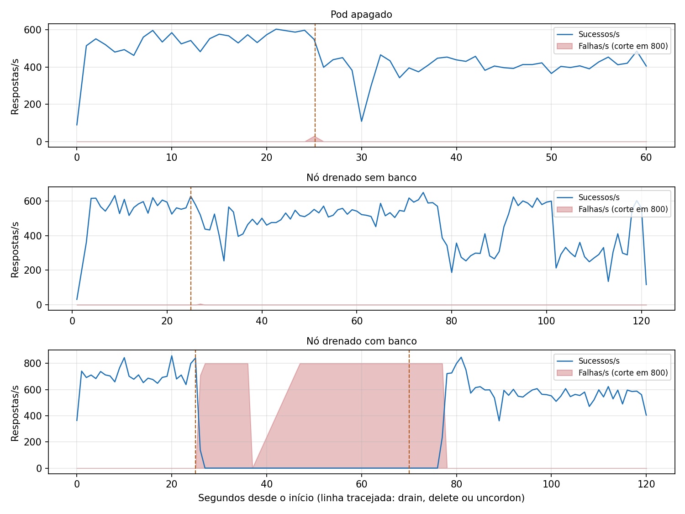
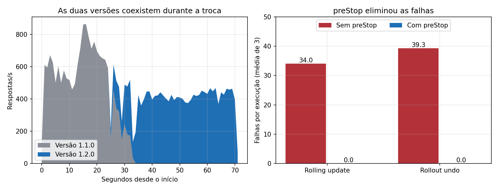
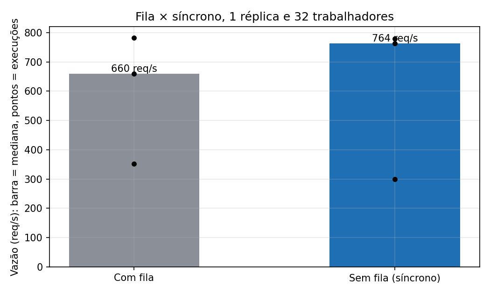

# Etapa 5: experimentos de escalabilidade e resiliência

Medições de 01/11/2026, comparadas com a linha de base da Etapa 4. As hipóteses foram registradas antes de medir, em
[hipoteses.md](hipoteses.md). Os arquivos brutos estão em `resultados/etapa5/`, os procedimentos em `carga/experimentos.py`
e as tabelas em `resultados/etapa5/tabelas.json`.

**Resultado principal:** escalar a API levou a vazão de ingestão de 616 para 1.378 req/s com 4 réplicas (2,24×, longe dos 4×
ideais), porque o gargalo passou da CPU do pod para o banco, que chegou ao limite de 1 núcleo. Antes disso, os experimentos
revelaram um defeito real: sem limite de conexões, as réplicas esgotavam o banco e derrubavam o sistema inteiro.

## Ambiente

| Item | Valor |
|---|---|
| Máquina | Intel Core i5-13450HX, 10 núcleos (16 threads), 15,7 GB de RAM |
| Cluster | k3d com 3 nós, todos na mesma máquina |
| Gerador | 4 processos do `carga/loadgen.py`, na mesma máquina do cluster |
| Serviço mais exigido | `air-quality-api`, rota `POST /air-quality/api/v1/air-quality/particulate` |
| Versões | Imagem `1.1.0`, e `1.2.0` no rolling update |

Usamos 4 processos porque um só limitaria a medição: na Etapa 4, ele usou 52% de um núcleo a 830 req/s.

## O defeito encontrado: conexões esgotadas

A primeira rodada contrariou a hipótese: com 4 e 8 réplicas a vazão **caiu**, e no HPA as 10 réplicas ficaram fora do ar por
mais de 2 minutos, com 97% de `503`.

Testamos a causa com 8 réplicas sob carga. O banco chegou a **100 conexões**, seu limite (`max_connections`), mas só 1 a 29
estavam ativas. O log do PostgreSQL registrou `FATAL: sorry, too many clients already`, e a API, o erro `53300`. Cada pod pode
abrir até 100 conexões, o padrão do Npgsql, então poucas réplicas ocupam todas as vagas com conexões ociosas. Como a
readiness consulta o banco, quando as vagas acabam todos os pods saem do balanceamento ao mesmo tempo.

**Correção:** `Maximum Pool Size=8` na string de conexão das três APIs. Com 10 réplicas, a API usa no máximo 80 conexões.

**Efeito:** nas 12 execuções de POST e no HPA, nenhuma requisição falhou. O HPA processou 244.835 requisições com 0 falhas.

Os dados "antes" foram mantidos (`51-r*`, `52-hpa`), mas a comparação tem uma ressalva: na primeira rodada a memória da
máquina chegou a 99%, contra até 96% na segunda, e a primeira série não teve
aquecimento dos pods. O teste direto das conexões é o que sustenta a causa.

| Réplicas | Vazão antes (req/s) | Erros antes (%) | Vazão depois (req/s) | Erros depois (%) |
|---:|---:|---:|---:|---:|
| 1 | 760 | 0 | 616 | 0 |
| 2 | 666 | 30,46 | 1.054 | 0 |
| 4 | 242 | 0,44 | 1.378 | 0 |
| 8 | 379 | 0,40 | 1.045 | 0 |

## 5.1 Escalabilidade horizontal manual

**Hipótese.** A vazão cresceria abaixo do ideal, entre 4× e 6× com 8 réplicas, e a fila acumularia menos.

**Procedimento.** HPA removido; `kubectl scale` para 1, 2, 4 e 8 réplicas; 64 trabalhadores, 60 s, 10 s de aquecimento,
3 execuções por nível. Fila vazia e pods prontos antes de cada execução. Pool limitado a 8 conexões.

**Evidências.** `resultados/etapa5/51b-*` (POST) e `51g-*` (GET).

**Tabela: POST (média de 3 execuções)**

| Réplicas | Vazão (req/s) | p50 (ms) | p95 (ms) | Erros (%) | Ganho medido | Ganho ideal | CPU das APIs (m) | CPU do banco (m) | Fila ao fim |
|---:|---:|---:|---:|---:|---:|---:|---:|---:|---:|
| 1 | 615,8 | 96,5 | 233,1 | 0 | 1,0 | 1 | 499 | 343 | 32.038 |
| 2 | 1.054,1 | 68,1 | 105,5 | 0 | 1,71 | 2 | 994 | 650 | 52.506 |
| 4 | 1.377,9 | 37,1 | 89,7 | 0 | 2,24 | 4 | 1.977 | 972 | 61.255 |
| 8 | 1.044,6 | 61,6 | 100,6 | 0 | 1,70 | 8 | 2.976 | 1.000 | 27.266 |

**Tabela: GET com cache (média de 3 execuções)**

| Réplicas | Vazão (req/s) | p50 (ms) | p95 (ms) | Erros (%) | Ganho medido | Ganho ideal |
|---:|---:|---:|---:|---:|---:|---:|
| 1 | 1.755,0 | 10,9 | 91,0 | 0 | 1,0 | 1 |
| 2 | 2.375,2 | 9,9 | 78,2 | 0 | 1,35 | 2 |
| 4 | 2.334,1 | 9,2 | 64,5 | 0 | 1,33 | 4 |
| 8 | 2.228,6 | 9,0 | 44,0 | 0 | 1,27 | 8 |

**Gráfico.**

**Análise crítica.** A hipótese de ganho foi **refutada**: o máximo foi 2,24×, com 4 réplicas.

- **Qual recurso limitou o POST:** o banco. Ele chegou a 972m com 4 réplicas e a 1.000m, o limite dele, com 8.
- **Lei de Amdahl:** com ganho de 2,24 em 4 réplicas, s = (4/2,24 − 1) / 3 ≈ **0,26**. Cerca de 26% do trabalho não se divide, e
  esse trecho é principalmente o banco único. Com esse s, a previsão para 8 réplicas seria 2,8×, mas medimos 1,70×.
- **Por que 8 réplicas renderam menos que 4:** Amdahl não prevê queda, então há outro efeito. Com 8 réplicas a fila terminou
  com menos da metade das mensagens (27 mil contra 61 mil). Estimando alertas processados por vazão − fila/60, foram cerca de
  590/s com 8 réplicas, contra 357/s com 4. Ou seja, mais consumidores disputam o banco com os POSTs. Essa conta é aproximada.
- **Hipótese da fila:** só parcialmente confirmada. Ela diminuiu com 8 réplicas, mas continuou acumulando em todos os níveis.
- **GET:** a vazão parou perto de 2.300 req/s já com 2 réplicas, mesmo com o banco quase parado e CPU sobrando. O limite está
  fora do pod: no gateway, no gerador ou na máquina, e não medimos qual. O ganho das réplicas apareceu na latência: o p95 caiu
  de 91 para 44 ms, o que sugere alívio do limite de 500m de CPU.
- **O que mudaria o resultado:** dar mais CPU ao banco, reduzir as consultas do consumidor de alertas, ou usar nós reais.

## 5.2 Escalabilidade automática (HPA)

**Hipótese.** Chegar a 10 réplicas em 1 a 2 minutos, com o p95 melhorando só depois de os pods ficarem prontos, e reduzir
cerca de 5 minutos após o fim da carga.

**Procedimento.** HPA por CPU (mínimo 2, máximo 10, meta de 50%); início com 2 réplicas; rampa de 1 a 64 trabalhadores em
120 s; 300 s de carga, sem aquecimento; 7 minutos de observação depois da carga. Uma execução.

**Evidências.** `52b-hpa-serie.csv`, `-eventos-k8s.json`, `-pods.json`, `-reducao.jsonl` e `-describe.txt`.

**Tabela.** Início da carga às 12:34:44.

| Evento | Hora | Tempo | Réplicas | Observação |
|---|---|---:|---:|---|
| Início da carga (rampa) | 12:34:44 | 0 s | 2 | CPU a 1% da meta |
| Primeira decisão (`SuccessfulRescale`) | 12:35:14 | 29 s | 4 | Depois: 8 aos 44 s e 10 aos 59 s |
| Novos pods prontos (`1/1`) | 12:35:51 | 67 s | 10 | 4 prontos aos 36 s, 8 aos 50 s |
| p95 de volta ao patamar | 12:35:38 | 54 s | 8 | p95 de 96 ms depois do pico de 1.733 ms aos 52 s; depois, picos isolados de até 207 ms |
| Fim da carga | 12:39:44 | 300 s | 10 | p95 geral de 105 ms, 0 falhas em 244.835 |
| Início da redução | 12:46:00 | 675 s | 4 | 2 réplicas às 12:46:15 |

**Gráfico.**

**Análise crítica.** A hipótese foi **confirmada**.

- **Atraso de reação:** 29 s até a primeira decisão, compatível com as parcelas do anexo da ficha: coleta de métricas e ciclo do
  HPA somam até 30 s. Da primeira decisão aos 10 pods prontos foram mais 38 s.
- **Picos na subida:** a vazão caiu por instantes perto de 36 s e 51 s, com p95 de até 1.733 ms, logo depois da entrada de novos
  pods. Pods recém-criados ainda aquecem o código, o que pode explicar, mas não foi isolado.
- **Vazão sustentada:** cerca de 940 req/s com 10 réplicas, abaixo das 1.378 req/s com 4 réplicas. O efeito é o mesmo da 5.1: o
  banco limita.
- **Redução:** começou 375 s depois do fim da carga, com a janela de estabilização de 5 minutos. A fila de 66 mil mensagens
  esvaziou em cerca de 1 minuto com 10 réplicas.
- **Sem a correção do pool,** o HPA piorou o sistema: mais réplicas esgotaram as conexões (execução `52-hpa`). Escalar sem olhar
  as dependências pode causar a queda.

## 5.3 Resiliência e autorrecuperação

**Hipótese.** Poucas falhas ao apagar um pod, substituto pronto em 5 a 7 s. Poucas falhas ao drenar nó sem banco. Banco
`Pending` e `503` ao drenar o nó com banco.

**Procedimento.** 16 trabalhadores constantes. Pod apagado: 2 réplicas, 60 s, `kubectl delete pod` aos 25 s, 3 execuções. Nó
drenado: 3 réplicas, 120 s, `kubectl drain` aos 25 s, uma execução por nó. No nó com banco, `kubectl uncordon` aos 70 s.

**Evidências.** `53-pod-exec*`, `53-no-sem-banco`, `53-no-com-banco` e os arquivos `-antes.txt` e `-depois.txt`.

**Tabela.** Em "patamar normal": sem erros e p95 até 1,5× o de antes, por 5 s seguidos.

| Cenário | Requisições | Falhas | Substituto pronto | Patamar normal |
|---|---:|---:|---:|---:|
| Pod apagado, execução 1 | 31.111 | 0 | 4,3 s | 10 s |
| Pod apagado, execução 2 | 27.895 | 29 (`502`) | 4,4 s | 0 s |
| Pod apagado, execução 3 | 28.300 | 10 (`502`) | 5,1 s | 6 s |
| Nó drenado sem banco (`server-0`) | 56.713 | 6 (`502`) | 6,1 s | 7 s |
| Nó drenado com banco (`agent-1`) | 378.472 | 334.738 | 61,7 s | 53 s |

**Gráfico.**

**Análise crítica.** As três hipóteses foram **confirmadas**, e o substituto foi um pouco mais rápido que o previsto.

- **Pod apagado:** as falhas são `502`, de requisições em andamento ou enviadas antes de o gateway saber que o pod saiu. A vazão
  ficou menor até o fim da execução no gráfico; o motivo não foi investigado.
- **Nó sem banco:** 6 falhas em 56.713. O `drain` encerra os pods com aviso, o que explica o resultado melhor que apagar um pod.
  Houve quedas de vazão perto de 80 s e 105 s, sem falhas e sem causa identificada.
- **Nó com banco:** o sistema parou por cerca de 53 s, até 8 s depois do `uncordon`. O volume `local-path` prende o Postgres
  ao nó, então ele não tem para onde ir. Além disso, o **Traefik estava no mesmo nó** e foi movido para o `server-0`. Por isso
  os erros incluem 14.703 `conexao_encerrada`, além de 320.013 `503`.
- **Quantidade de falhas:** o número alto vem do laço fechado: um `503` é tão rápido que os trabalhadores repetem milhares de
  vezes por segundo. O dado relevante é o tempo fora do ar, e não a contagem.
- **O que mudaria o resultado:** réplica do banco e armazenamento em rede. Um PodDisruptionBudget faria o `drain` esperar em vez de
  despejar o único pod do banco, mas a manutenção do nó continuaria bloqueada.

## 5.4 Atualização sem interrupção

**Hipótese.** Poucas falhas sem `preStop`, menos ou zero com `preStop`, e as duas versões coexistindo.

**Procedimento.** 3 réplicas, 16 trabalhadores, 70 s. `kubectl set image` para 1.2.0 aos 20 s; em seguida, nova execução com
`kubectl rollout undo` aos 20 s. Com e sem `preStop` (`sleep 5`), 3 execuções de cada. `maxSurge: 1`, `maxUnavailable: 0`.

**Evidências.** `54-*` e `54-rollout-history.txt`. O cabeçalho `X-Versao` está em cada linha do `-requisicoes.csv`.

**Tabela (por execução)**

| Cenário | Requisições | Falhas | Duração da troca | Coexistência das versões | Versões vistas |
|---|---:|---:|---:|---:|---|
| Rolling update sem `preStop` | 27.565 a 29.861 | 24 a 44 | 12,6 a 15,3 s | 1 a 2 s | 1.1.0 e 1.2.0 |
| Rollout undo sem `preStop` | 26.894 a 27.421 | 28 a 47 | 13,2 a 13,6 s | 1 a 2 s | 1.2.0 e 1.1.0 |
| Rolling update com `preStop` | 23.741 a 34.437 | **0** | 13,0 a 16,0 s | 9 a 11 s | 1.1.0 e 1.2.0 |
| Rollout undo com `preStop` | 32.720 a 33.856 | **0** | 12,5 a 13,8 s | 7 a 10 s | 1.2.0 e 1.1.0 |

**Gráfico.**

**Análise crítica.** A hipótese foi **confirmada**, com resultado melhor que o esperado: 0 falhas nas 6 execuções com `preStop`,
contra 24 a 47 nas 6 sem ele.

- **Por que funciona:** sem `preStop`, o pod recebe o sinal de encerramento enquanto o gateway ainda envia requisições, o que gera
  `502`. Em cada execução sem `preStop` houve também exatamente 16 timeouts. O número coincide com o de trabalhadores, mas a
  causa não foi investigada. Os 5 s de espera dão tempo de o gateway atualizar a lista de destinos.
- **Custo:** quase nenhum na duração da troca, que continuou entre 12 e 16 s. As versões coexistem por mais tempo, então a API precisa
  aceitar as duas ao mesmo tempo.
- **Undo:** comportou-se como outro rolling update, como previsto.
- **Vazão:** foi maior nas execuções com `preStop` (em média, 446 contra 368 req/s). Não atribuímos isso ao `preStop`, porque
  elas rodaram depois e com pods já aquecidos.
- **Decisão:** o `preStop` de 5 s foi incorporado aos manifestos das três APIs em `k8s/`, junto com o limite do pool.

## 5.5 Efeito do processamento assíncrono

**Hipótese.** Sem fila, o POST ficaria mais lento e a vazão cairia, mas nada acumularia.

**Procedimento.** 1 réplica, 32 trabalhadores, 60 s, 10 s de aquecimento, 3 execuções de cada. Sem fila: variável
`ConnectionStrings__RabbitMq` vazia, e a API avalia o alerta dentro do POST.

**Evidências.** `55-com-fila-*` e `55-sem-fila-*`.

**Tabela (mediana de 3 execuções)**

| Cenário | Vazão (req/s) | p50 (ms) | p95 (ms) | Erros (%) | CPU do banco (m) | Fila ao fim |
|---|---:|---:|---:|---:|---:|---:|
| Com fila | 659,8 | 19,6 | 93,8 | 0 | 351 | cerca de 34 mil |
| Sem fila (síncrono) | 763,5 | 34,2 | 88,9 | 0 | 429 | 0 |

**Gráfico.**

**Análise crítica.** A hipótese foi **parcialmente confirmada**.

- **Confirmado:** o POST típico ficou mais lento, com p50 de 19,6 para 34,2 ms, e nada acumulou.
- **Refutado:** a vazão não caiu. Pela mediana ela até subiu, mas as execuções variaram demais para afirmar isso.
- **Variação:** a primeira execução de cada cenário foi bem mais lenta (352 e 299 req/s), logo depois do reinício do pod, e por
  isso usamos a mediana. Esse aquecimento só foi incluído nas séries seguintes.
- **Interpretação:** a fila não reduz o trabalho total, só o adia. Com ela, o sistema termina o teste devendo cerca de 34 mil
  avaliações de alerta. Em um pod só, os dois trabalhos disputam os mesmos 500m de CPU.
- **Conclusão prática:** a fila vale pela resposta rápida e pela absorção de picos, mas aceita alertas atrasados. Sob carga contínua,
  o alerta de um alagamento poderia chegar minutos depois. Para isso, seria melhor separar o consumidor em um serviço próprio.

## Limitações gerais

- Todos os nós dividem a mesma máquina, então o ganho medido inclui essa disputa.
- A memória da máquina esteve alta durante os testes, chegando a 99% na primeira rodada.
- O HPA e cada drenagem de nó têm uma execução; os demais experimentos, três.
- A CPU do Traefik e dos processos do gerador não foi medida separadamente.
- O ponto de saturação da Etapa 4 foi medido com outra quantidade de processos do gerador, então a comparação é aproximada.
- As execuções da 5.3 a 5.5 usaram o pool sem limite, mas com 1 a 3 réplicas, abaixo do ponto em que as conexões acabam.
